# Real-world Setup
We mount a [Jetson Orin AGX 64GB](https://www.nvidia.com/en-us/autonomous-machines/embedded-systems/jetson-orin/) on the [Unitree Go2](https://www.unitree.com/go2) robot.  
For detailed hardware information and CAD files, please refer to [REASAN](https://arxiv.org/pdf/2512.09537v1).
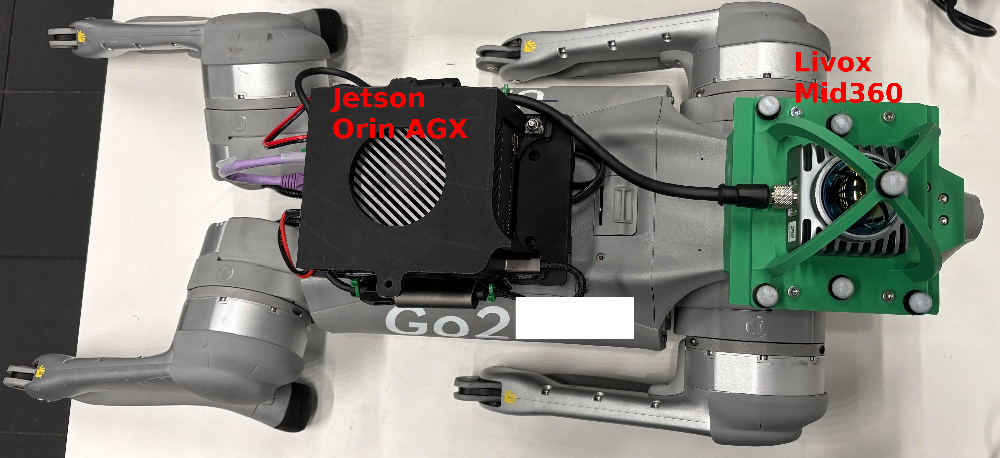

## NVIDIA Jetson AGX Orin Setup

### Flash the System

- Hardware setup follow the [guidance](https://developer.nvidia.com/embedded/learn/jetson-agx-orin-devkit-user-guide/two_ways_to_set_up_software.html#hardware-setup)
    - First finish L4T BSP flash step
- SDK Manager Step1
    - choose **Jetson AGX Orin \[64GB developer kit version\],  JetPack 6.2.1**  
    - **Do NOT select Host Machine**
	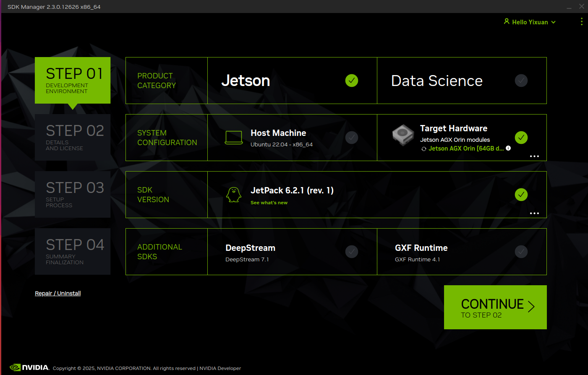
- SDK Manager Step2
    - **Only** select the first Jetson Linux  
    - Do **NOT** select Jetson Runtime Components
	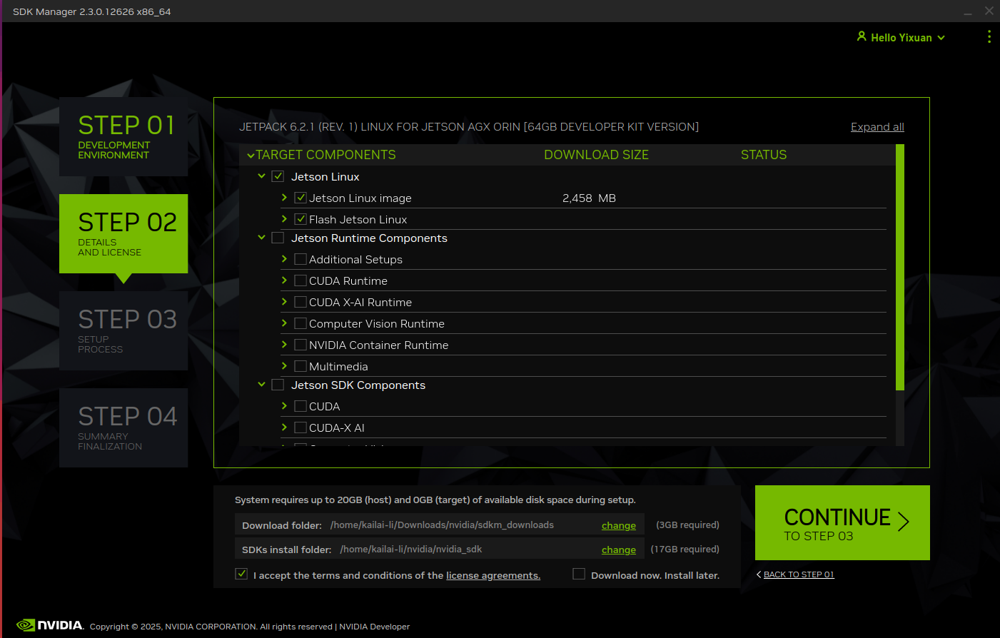
	Click **Contine**  
	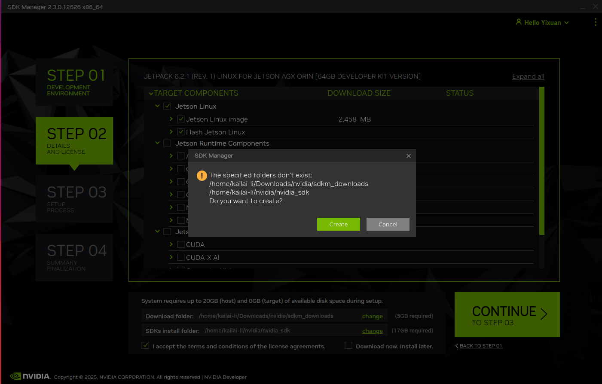 
	Click **Create**  
	Then click **Continue** and input your sudo password
- SDK Manager Step3
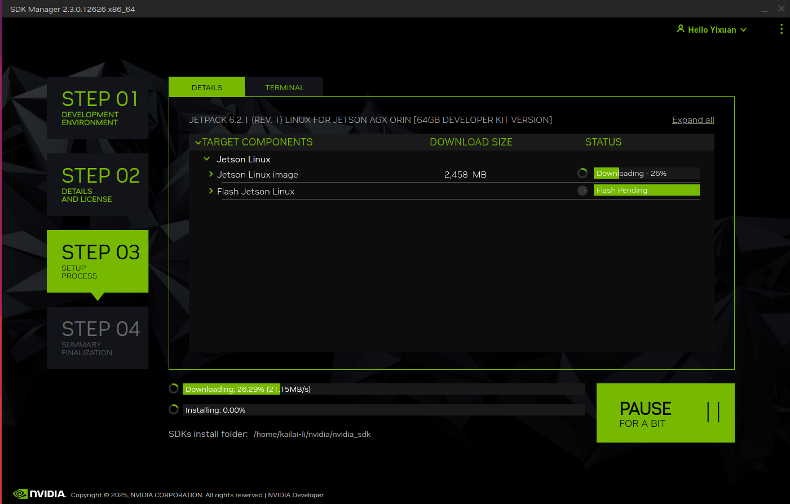
**IMPORTANT\!**  
**Choose RUNTIME and NVME (if with ssd inside)**  
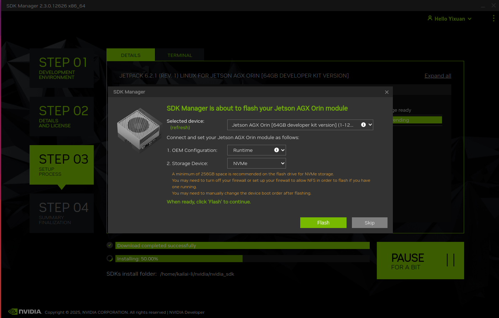  
Click **Flash**  
After a while, it goes back to this page again  
**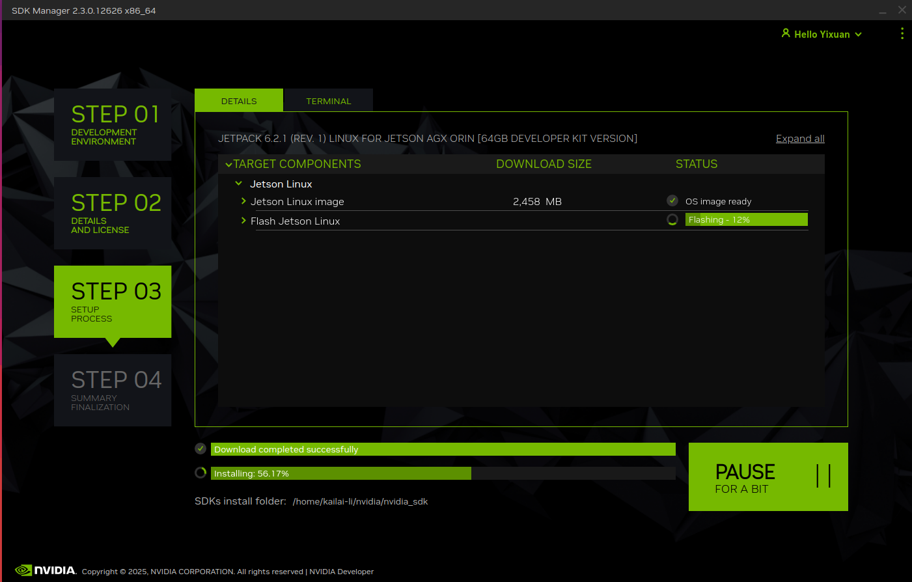**  
Usually this step takes about 5-8 minutes
- SDK Manager Step4
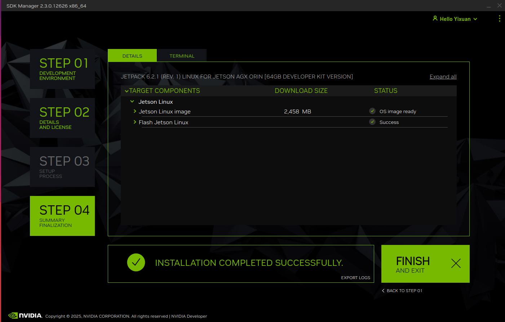  
Done!

### Install SDK Components

First make sure you finish first flashing step and install ubuntu already, finish ubuntu initial setups first.
Do **NOT** run `sudo apt update` or `upgrade` at this step, it may cause version mismatch errors later.
Follow [this guide](https://developer.nvidia.com/embedded/learn/jetson-agx-orin-devkit-user-guide/two_ways_to_set_up_software.html#1-how-to-use-sdk-manager-to-flash-l4t-bsp).

- SDK Manager Step 1  
No need to make AGX Orin be in Force Recovery Mode, just wait for some time then it can be detected.
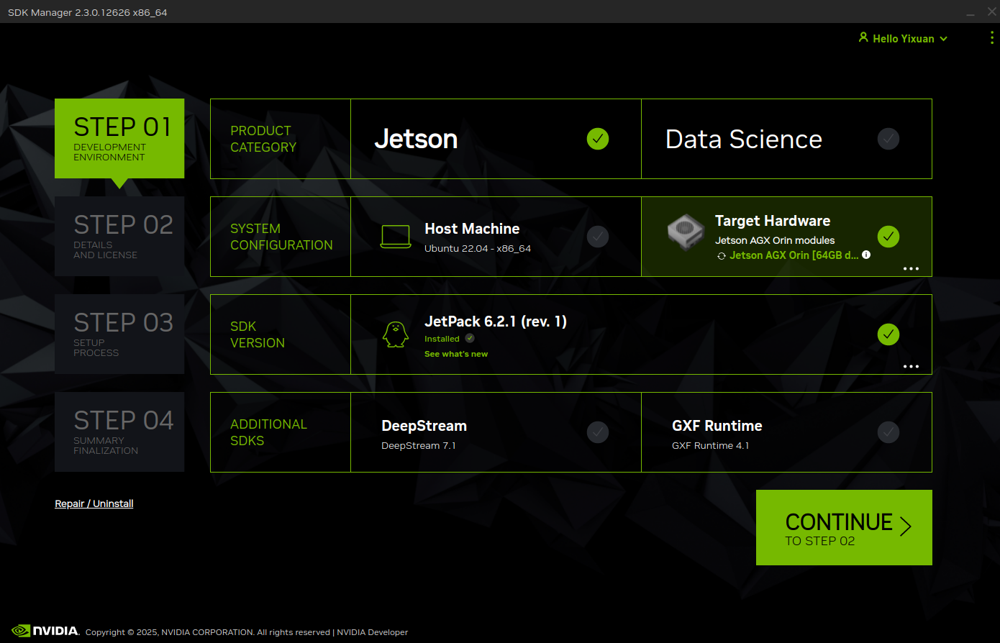
- SDK Manager Step 2  
Select SDK components we want:  
When you click SDK components, some Runtime components required for SDK components will be automatically selected.
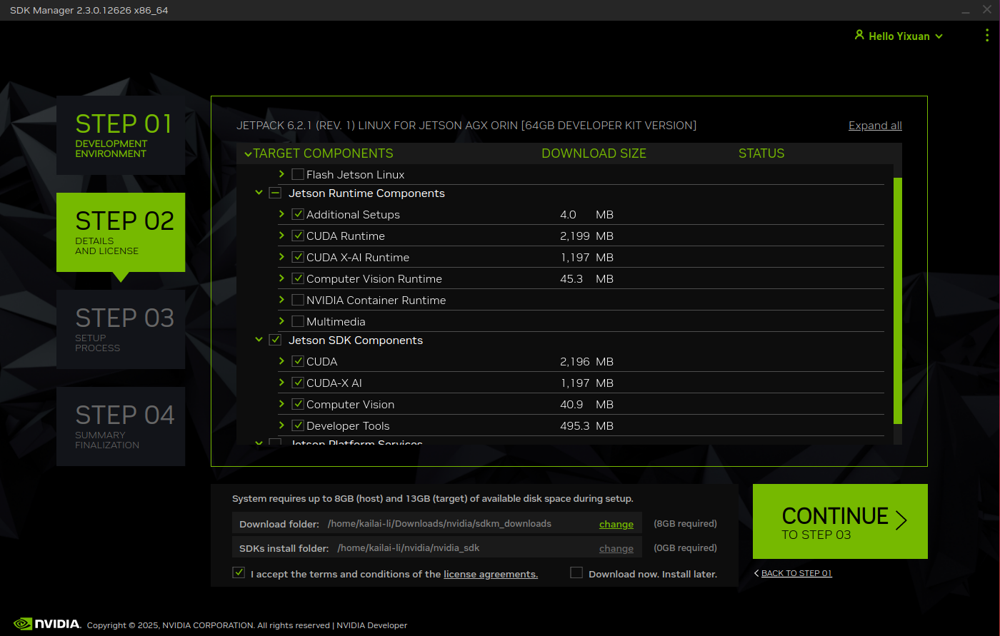
Click Continue and input your sudo password.
- SDK Manager Step 3  
And set configuration like this.
Input username and password you set for ubuntu in jetson agx orin:
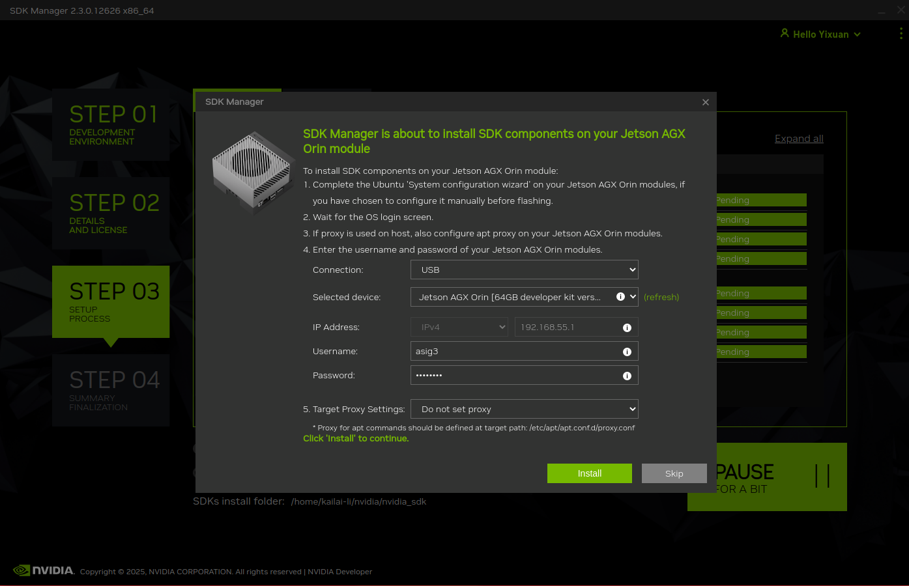
Click install:
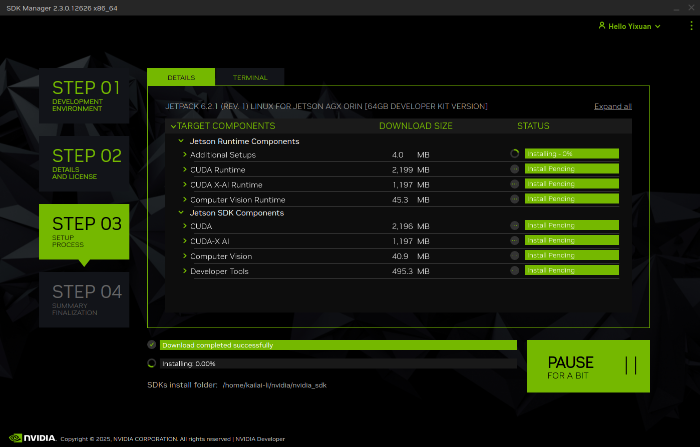
**Notes:**  
Sometimes it encounters device image version matching requirement, follow [this guide](https://forums.developer.nvidia.com/t/error-installing-jetpack-6-2-1/337555/5).
This may be caused by `sudo apt update` and `upgrade` at initial setups of ubuntu, you can reflash Jetson AGX Orin to solve this mismatch.
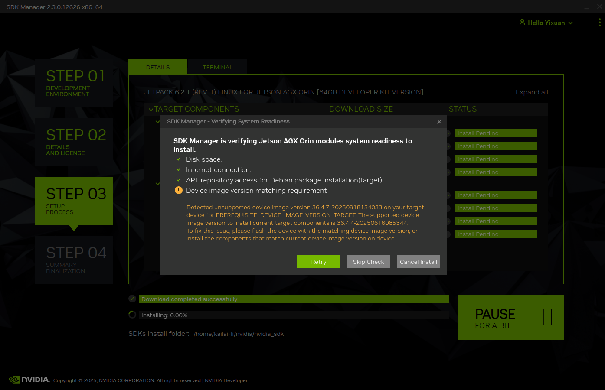
- SDK Manager Step 4  
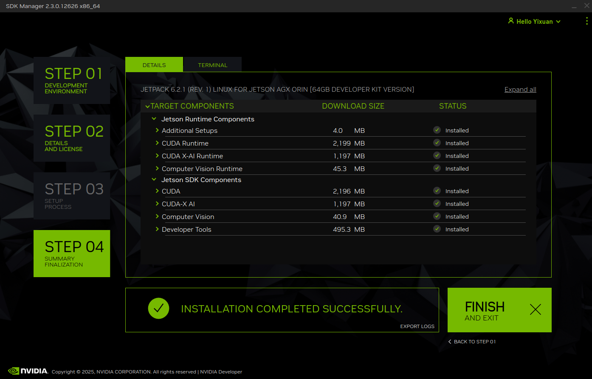

## Student Project Examples

- **Towards Multimodal Autonomous Exploration Onboard Legged Robot** ([Poster](https://asig-x.github.io/comenius/posters/Kees_2025_MSc_Project.pdf))  
K. Wierenga, Master’s thesis, MSc Computing Science, University of Groningen (RUG), 2025.  
- **Towards Reinforcement Learning-Based Quadrupedal Navigation**
L. M. Quirós, Bachelor’s thesis, University of Groningen (RUG), 2025.