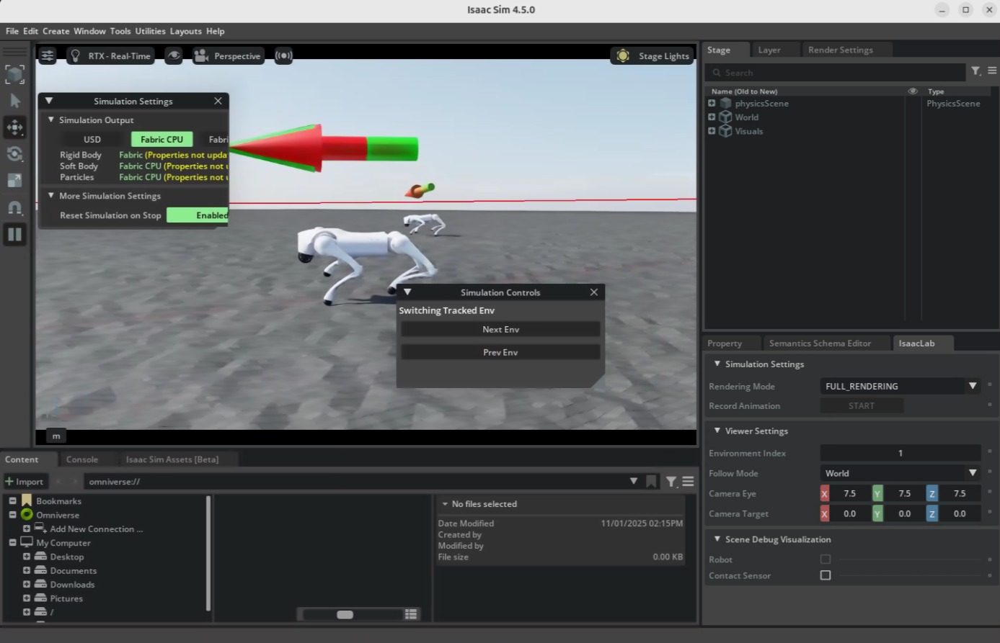

# IsaacLab Training

Code is available [here](https://github.com/ASIG-X/asig_sim2real).

## Installation

First create a new conda environment:
```bash
conda create -n env_go2 python=3.10
conda activate env_go2
```

Install PyTorch:
```bash
pip install torch==2.7.0 torchvision==0.22.0 --index-url https://download.pytorch.org/whl/cu128
```

Install IsaacSim 4.5.0:
```bash
pip install --upgrade pip
pip install 'isaacsim[all,extscache]==4.5.0' --extra-index-url https://pypi.nvidia.com
```

Install IsaacLab and others inside the cloned folder:
```bash
./isaaclab.sh --install
pip install -e ./rsl_rl
pip install -e ./asig_sim2real
```

## Training and Playing


```bash
python scripts/train.py --run_name policy_1
```

Training output would be something like this:
{ width="500" }

```bash
python scripts/play.py --load_run policy_1
```

For the first time, it may take some time to build the shaders. 
{ width="500" }

## Export ONNX Model

After being played, the ONNX model of the policy will be exported, which is needed for deployment.


Inside logs/rsl_rl/asig_sim2real/policy_1/exported you can find the policy.onnx exported just now.
Copy this file to the deployment folder:

```bash
cp ./logs/rsl_rl/asig_sim2real/policy_1/exported/policy.onnx ./deployment/model
```

## Sim-to-Sim Deployment with MuJoCo

### Build deployment code

Now we have the ONNX model, we can build the deployment code.

First install dependencies:

- Install ROS2 Humble following [this guide](https://docs.ros.org/en/humble/Installation/Ubuntu-Install-Debs.html)

- Install [unitree_sdk2](https://github.com/unitreerobotics/unitree_sdk2)

- Install other dependencies
```base
sudo apt install libeigen3-dev libfmt-dev
```

- Install onnxruntime

    * Go to the [release page](https://github.com/microsoft/onnxruntime/releases) and download prebuilt binaries. 
    Please download this file (tested): onnxruntime-linux-x64-gpu-1.22.0.tgz

    * Extract the folder and copy the “include” folder to “/usr/local”.

    * Copy the “lib” folder as “/usr/local/lib64”.

    * Copy the “lib/cmake” folder to “/usr/local/lib”.

    * Add “/usr/local/lib64” to your “LD_LIBRARY_PATH”:
    ```base
    export LD_LIBRARY_PATH=/usr/local/lib64:$LD_LIBRARY_PATH
    ```

- Download TensorRT 10.9 GA from here and extract to a separate folder. 
You should download this one:
**TensorRT 10.9 GA for Linux x86_64 and CUDA 12.0 to 12.8 TAR Package**.
Then Add “lib” folder of extracted TensorRT to your “LD_LIBRARY_PATH”:
```base
export LD_LIBRARY_PATH=/absolute/path/to/tensorrt/lib:$LD_LIBRARY_PATH
```

- Install cuda-12.8 and cudnn-9 and add to LD_LIBRARY_PATH  
Install cuda-12.8 follow [this](https://developer.nvidia.com/cuda-12-8-0-download-archive?target_os=Linux&target_arch=x86_64&Distribution=Ubuntu&target_version=22.04&target_type=deb_local).  
Install cudnn-9 follow [this](https://developer.nvidia.com/cudnn-downloads?target_os=Linux&target_arch=x86_64&Distribution=Ubuntu&target_version=22.04&target_type=deb_local).  
Then:
```bash
export PATH=/usr/local/cuda-12.8/bin${PATH:+:${PATH}}
export LD_LIBRARY_PATH=/usr/local/cuda-12.8/lib64${LD_LIBRARY_PATH:+:${LD_LIBRARY_PATH}}
```

Now the dependencies should be fine, go back to the asig_sim2real folder and build the deployment code:
```bash
cd deployment
./run_build.sh
```

### Deploy in MuJoCo.

Follow [this link](https://github.com/unitreerobotics/unitree_mujoco) to install unitree_mujoco to a separate folder. 
If you install c++ version, follow official guidance to install mujoco.

Make sure you install MuJoCo 3.2.7 using:
```bash
pip install mujoco==3.2.7
```

Notes:
You need to clone unitree_mujoco to local
After installation following official guidance, open unitree_mujoco/simulate_python/config.py, set USE_JOYSTICK = 0.
In MuJoCo it should look like this:


After installation, launch the unitree_mujoco simulator (both Python and C++ version work) in unitree_mujoco folder
```bash
# this is for c++ version
cd unitree_mujoco/simulate/build
./unitree_mujoco # assuming you have build output here

# this is for python version
cd unitree_mujoco/simulate_python
python3 ./unitree_mujoco.py
```

Finally, start the control nodes in asig_sim2real/deployment folder
(If you encounter errors, try to deactivate the conda environment):
```bash
# terminal 1: deploy onnx model
./locomotion_node --net lo --policy loco_policy # or loco_policy (the pretrained policy)
# terminal 2: keyboard control
python terminal_control.py
```

## Deployment on Real Robot

### Flash Jetson Orin AGX

First we need to flash Nvidia Jetson Orin AGX and install SDK packages like cuda, cudnn, tensorrt and so on.
Check the [deployment docuement](go2_deployment.md) for details on flashing the system and installing components.

### Install Dependencies

Log into Jetson AGX Orin ubuntu system and check whether required packages are installed correctly:
```bash
nvcc –version
ls -l /usr/local/cuda
ls /usr/lib/aarch64-linux-gnu/libcudnn*
ls /usr/lib/aarch64-linux-gnu/libnvinfer*
```
If not, you can try to follow the components installation guide again.

Install [ROS2 humble](https://docs.ros.org/en/humble/index.html).

Install [unitree sdk2](https://github.com/unitreerobotics/unitree_sdk2).

Install [unitree sdk2 python](https://github.com/unitreerobotics/unitree_sdk2_python) follow their official guide.
When following the last code block of FAQ-1, change the commands to:
```bash
#use the following commands instead of those given in repository
cd ~/unitree_sdk2_python
export CYCLONEDDS_HOME=/home/usrname/cyclonedds/install
# if this doesn't work, try this one
export CYCLONEDDS_HOME=$HOME/cyclonedds/install

pip3 install -e . --no-build-isolation
```

Install required packages for the deployment code:
```bash
sudo apt install libeigen3-dev libfmt-dev
```

Install onnxruntime, compile procedures are based on [official manuscript](https://onnxruntime.ai/docs/build/eps.html#nvidia-jetson-tx1tx2nanoxavierorin).

   - Onnxruntime v1.23.2:  **install from source**
   ```bash
   git clone --recursive https://github.com/microsoft/onnxruntime

   sudo apt install -y --no-install-recommends \
   build-essential software-properties-common libopenblas-dev \
   libpython3.10-dev python3-pip python3-dev python3-setuptools python3-wheel
   ```
   - Install cmake 3.28.5, find files in [https://cmake.org/files/v3.28/](https://cmake.org/files/v3.28/).
   Choose [`cmake-3.28.5-linux-aarch64.sh`](https://cmake.org/files/v3.28/cmake-3.28.5-linux-aarch64.sh).
   ```bash
   chmod +x ./cmake-3.28.5-linux-aarch64.sh
   sudo ./cmake-3.28.5-linux-aarch64.sh --prefix=/usr/local

   # check cmake version; should be 3.28 now
   cmake --version

   # if you encounter errors or version not update, reboot may simply solve problem
   ```
   - Go to cloned [`onnxruntime`](https://github.com/microsoft/onnxruntime) project.
   Make sure you set **onnxruntime\_BUILD\_UNIT\_TESTS=OFF** , more details in [github](https://github.com/microsoft/onnxruntime/issues/26425).
   ```bash
   ./build.sh --config Release --update --build --parallel --use_tensorrt --cuda_home /usr/local/cuda --cudnn_home /usr/lib/aarch64-linux-gnu --tensorrt_home /usr/lib/aarch64-linux-gnu --skip_tests --cmake_extra_defines 'CMAKE_CUDA_ARCHITECTURES=native''onnxruntime_BUILD_UNIT_TESTS=OFF' --build_shared_lib

   cd build/Linux/Release
   sudo make install

   cd /usr/local/lib/cmake/onnxruntime
   sudo vim ./onnxruntimeTargets-release.cmake
   # change all "lib64" to "lib" and save
   ```

### Build Deployment Code

```bash
# before run this, make sure you source livox_driver, mocap and unitree driver first

cd ~/asig_sim2real/deployment
./run_build.sh

# if you encounter onnxruntime error again, run this:
sudo cp -r /usr/local/include/onnxruntime /usr/local/include/
```

### Deploy and Control

Make sure your Jetson is in the same subnet as your PC.
For example, Jetson IP can be 192.168.20.1, and the IP of your PC can be 192.168.20.2.
On both computers, set the network IPv4 to be manual, and the network mask should be 255.255.255.0.
After this, you should be able to communicate with ROS2 on both computers.
Then, similarly to the Sim-to-Sim deployment, run the control script on your PC, and run the deployment code on Jetson:
```bash
# on your pc
python terminal_control.py

# on jetson
export NET_INTERFACE=network # network interface name on jetson connecting to the robot (e.g., eno1)
./locomotion_node --net <network interface> --policy loco_policy # or loco_policy
```

## DISCLAIMER

***WARNING — REAL ROBOT DEPLOYMENT***

Always validate your controller in MuJoCo simulation before deploying
to hardware. This document is provided as-is, for reference only, with
no guarantee of correctness or safety.

Real robots can move suddenly and with significant force. Hardware and
software setups vary, and behavior that works in simulation may fail
on hardware. Before running anything:

- Keep an emergency stop within reach at all times
- Clear the workspace of people and obstacles
- Start with reduced torque/velocity limits
- Never assume the robot will behave as expected

You are solely responsible for ensuring the safety of people and
equipment when using this document and the accompanying code.