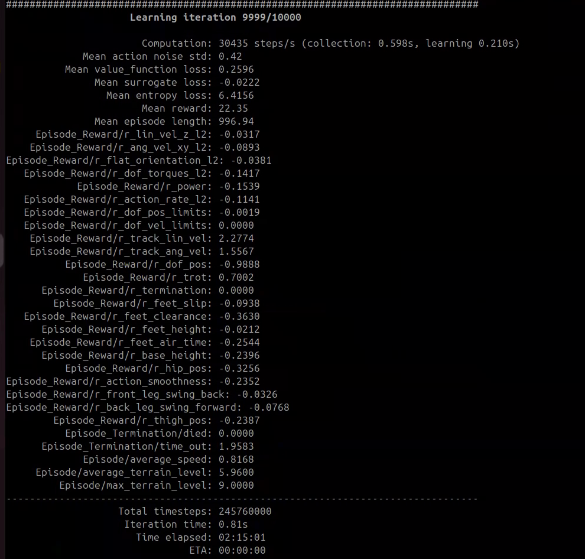
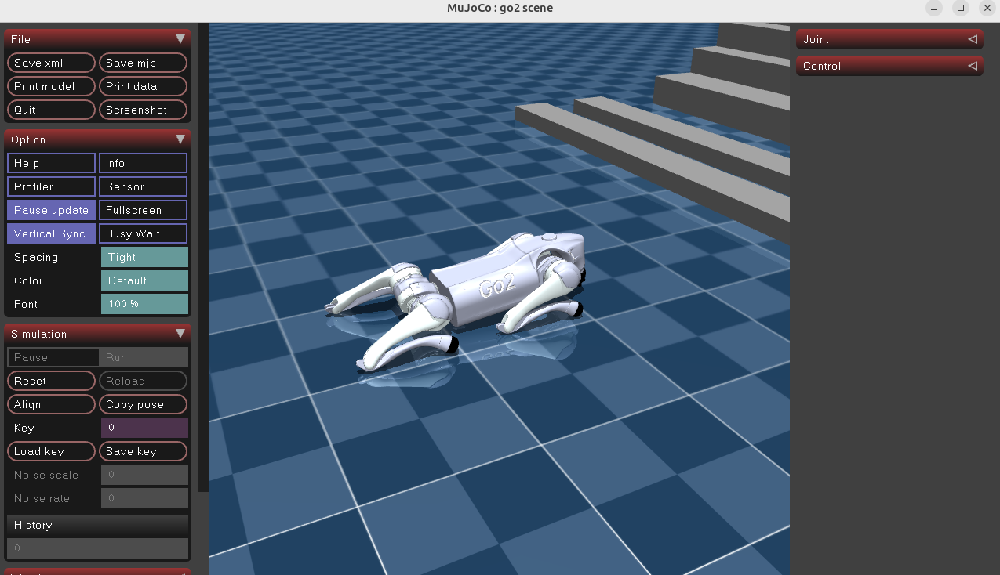

# IsaacLab Training

Code is available [here](https://github.com/ASIG-X/asig_sim2real).

## Installation

First create a new conda environment:
```bash
conda create -n env_go2 python=3.10
conda activate env_go2
```

Install PyTorch:
```bash
pip install torch==2.7.0 torchvision==0.22.0 --index-url https://download.pytorch.org/whl/cu128
```

Install IsaacSim 4.5.0:
```bash
pip install --upgrade pip
pip install 'isaacsim[all,extscache]==4.5.0' --extra-index-url https://pypi.nvidia.com
```

Install IsaacLab and others inside the cloned folder:
```bash
./isaaclab.sh --install
pip install -e ./rsl_rl
pip install -e ./asig_sim2real
```

## Training and Playing


```bash
python scripts/train.py --run_name policy_1
```

Training output would be something like this:
{ width="500" }

```bash
python scripts/play.py --load_run policy_1
```

For the first time, it may take some time to build the shaders. 
{ width="500" }

## Export ONNX Model

After being played, the ONNX model of the policy will be exported, which is needed for deployment.


Inside logs/rsl_rl/asig_sim2real/policy_1/exported you can find the policy.onnx exported just now.
Copy this file to the deployment folder:

```bash
cp ./logs/rsl_rl/asig_sim2real/policy_1/exported/policy.onnx ./deployment/model
```

## Sim-to-Sim Deployment with MuJoCo

### Build deployment code

Now we have the ONNX model, we can build the deployment code.

First install dependencies:

- Install ROS2 Humble following [this guide](https://docs.ros.org/en/humble/Installation/Ubuntu-Install-Debs.html)

- Install (unitree_sdk2)[https://github.com/unitreerobotics/unitree_sdk2]

- Install other dependencies
```base
sudo apt install libeigen3-dev libfmt-dev
```

- Install onnxruntime

    * Go to the (release page)[https://github.com/microsoft/onnxruntime/releases] and download prebuilt binaries. 
    Please download this file (tested): onnxruntime-linux-x64-gpu-1.22.0.tgz

    * Extract the folder and copy the “include” folder to “/usr/local”.

    * Copy the “lib” folder as “/usr/local/lib64”.

    * Copy the “lib/cmake” folder to “/usr/local/lib”.

    * Add “/usr/local/lib64” to your “LD_LIBRARY_PATH”:
    ```base
    export LD_LIBRARY_PATH=/usr/local/lib64:$LD_LIBRARY_PATH
    ```

- Download TensorRT 10.9 GA from here and extract to a separate folder. 
You should download this one:
**TensorRT 10.9 GA for Linux x86_64 and CUDA 12.0 to 12.8 TAR Package**.
Then Add “lib” folder of extracted TensorRT to your “LD_LIBRARY_PATH”:
```base
export LD_LIBRARY_PATH=/absolute/path/to/tensorrt/lib:$LD_LIBRARY_PATH
```

- Install cuda-12.8 and cudnn-9 and add to LD_LIBRARY_PATH  
Install cuda-12.8 follow [this](https://developer.nvidia.com/cuda-12-8-0-download-archive?target_os=Linux&target_arch=x86_64&Distribution=Ubuntu&target_version=22.04&target_type=deb_local).  
Install cudnn-9 follow [this](https://developer.nvidia.com/cudnn-downloads?target_os=Linux&target_arch=x86_64&Distribution=Ubuntu&target_version=22.04&target_type=deb_local).  
Then:
```bash
export PATH=/usr/local/cuda-12.8/bin${PATH:+:${PATH}}
export LD_LIBRARY_PATH=/usr/local/cuda-12.8/lib64${LD_LIBRARY_PATH:+:${LD_LIBRARY_PATH}}
```

Now the dependencies should be fine, go back to the asig_sim2real folder and build the deployment code:
```bash
cd deployment
./run_build.sh
```

### Deploy in MuJoCo.

Follow [this link](https://github.com/unitreerobotics/unitree_mujoco) to install unitree_mujoco to a separate folder. 
If you install c++ version, follow official guidance to install mujoco.

Make sure you install MuJoCo 3.2.7 using:
```bash
pip install mujoco==3.2.7
```

Notes:
You need to clone unitree_mujoco to local
After installation following official guidance, open unitree_mujoco/simulate_python/config.py, set USE_JOYSTICK = 0.
In MuJoCo it should look like this:


After installation, launch the unitree_mujoco simulator (both Python and C++ version work) in unitree_mujoco folder
```bash
# this is for c++ version
cd unitree_mujoco/simulate/build
./unitree_mujoco # assuming you have build output here

# this is for python version
cd unitree_mujoco/simulate_python
python3 ./unitree_mujoco.py
```

Finally, start the control nodes in asig_sim2real/deployment folder
(If you encounter errors, try to deactivate the conda environment):
```bash
# terminal 1: deploy onnx model
./locomotion_node --net lo --policy loco_policy # or loco_policy (the pretrained policy)
# terminal 2: keyboard control
python terminal_control.py
```

## Deployment on Real Robot

### Flash Jetson Orin AGX

First we need to flash Nvidia Jetson Orin AGX with packages like cuda, cudnn, tensorrt and so on.


First, install ROS2 Humble, unitree\_sdk2, libeigen3-dev and libfmt-dev on Jetson Orin similarly as described previously.

Then we will install onnxruntime with TensorRT backend. Check [this](https://onnxruntime.ai/docs/build/eps.html#tensorrt) for a more comprehensive guide.

Jetpack should already come with CUDA, cuDNN, and TensorRT.

Now we just need to install onnxruntime.

```shell
cd
git clone https://github.com/microsoft/onnxruntime.git --branch v1.22.2
cd onnxruntime

# TODO: the paths to CUDA, cuDNN and TensorRT need to be verified
./build.sh --config Release --parallel --cmake_extra_defines 'CMAKE_CUDA_ARCHITECTURES=native' --cudnn_home /usr/lib/x86_64-linux-gnu/ --cuda_home /usr/local/cuda --use_tensorrt --tensorrt_home /usr/local

# TODO: build folder needs verification
cd build
# TODO: installation needs verification
sudo make install
```

Now go back to your laptop and copy the deployment code to Jetson. Make sure your laptop and Jetson are on the same subnet and can ping each other.

```shell
scp -r asig_sim2real/deployment username@xxx.xxx.xxx.xxx:~/go2_deployment
```

Now you can ssh into Jetson and start the deployment:

```shell
# ssh into Jetson
ssh username@xxx.xxx.xxx.xxx

# get two terminals. in one terminal run:
cd go2_deployment
./run_build.sh
# you can get the network interface connecting to the robot with ifconfig
./locomotion_node --policy policy_1 --net XXX

# in another terminal, run:
cd go2_deployment
python terminal_control.py

# now you can control the robot as in MuJoCo
```

## **Jetson AGX Orin Deployment step-by-step configuration**

1. Initial Setup for Jetson AGX Orin   
   1. Flash Orin: Follow our [step-by-step flashing tutorial](?tab=t.v9bhny4sguw0#heading=h.vyhnccxlee7a)  
      1. Get into ubuntu and finish initial setups  
         Username: asig1, asig2, asig3  
         Password: asigorin  
      2. Do **NOT** run sudo apt update ,  sudo apt upgrade and sudo apt dist-upgrade after flashing, this may cause some packages version mismatch at step 1.b  
   2. Install basic Cuda, Cudnn, TensorRT using SDK manager, follow our [step-by-step installing tutorial](?tab=t.v9bhny4sguw0)  
      1. If you install these packages in ubuntu terminal, some versions are incorrect, make sure you use SDK manager to install

	  
After installation, get into Jetson AGX Orin ubuntu system  
	Open terminal and check whether CUDA is installed correctly

```shell
nvcc –version
ls -l /usr/local/cuda
ls /usr/lib/aarch64-linux-gnu/libcudnn*
ls /usr/lib/aarch64-linux-gnu/libnvinfer*
```

2. Install [ROS2 humble](https://docs.ros.org/en/humble/index.html)  
3. Install [unitree sdk2](https://github.com/unitreerobotics/unitree_sdk2)  
4. Install [unitree sdk2 python](https://github.com/unitreerobotics/unitree_sdk2_python) follow their official processes  
   1. When following FAQ1 last code block, change commands as follows:

```shell
#use the following commands instead of those given in repository
cd ~/unitree_sdk2_python
export CYCLONEDDS_HOME=/home/usrname/cyclonedds/install
# if this doesn't work, try this one
export CYCLONEDDS_HOME=$HOME/cyclonedds/install

pip3 install -e . --no-build-isolation
```

5. Install [livox ros2 driver](https://github.com/Livox-SDK/livox_ros_driver2)  
   1. In [this guidance](https://github.com/Livox-SDK/Livox-SDK2/blob/master/README.md) 2.2 step2, run this command, then run step3

```shell
sudo apt install cmake build-essential
```

   2. In [step 2.3](https://github.com/Livox-SDK/livox_ros_driver2?tab=readme-ov-file#23-build-the-livox-ros-driver-2), in the folder ws\_livox/ src/livoc\_ros\_driver2/  run ./build.sh humble  
   3. In [step 2.4](https://github.com/Livox-SDK/livox_ros_driver2?tab=readme-ov-file#24-run-livox-ros-driver-2), run

```shell
source ../../install/setup.sh
ros2 launch livox_ros_driver2 msg_MID360_launch.py
```

6. Install [camera tracking driver](https://github.com/MOCAP4ROS2-Project/mocap4ros2_qualisys)  
   1. In setup your qualisys configuration step, 

```shell
gedit mocap_ws/src/mocap4ros2_qualisys/qualisys_driver/config/qualisys_driver_params.yaml
# then revise host address to your own ip address
# need to recompile
cd ~/mocap_ws
colcon build --symlink-install
source install/setup.bash
```

7. Install dependencies:

```shell
sudo apt install libeigen3-dev libfmt-dev
```

8. Install onnxruntime, compile procedures are based on [official manuscript](https://onnxruntime.ai/docs/build/eps.html#nvidia-jetson-tx1tx2nanoxavierorin)  
   1. Onnxruntime v1.23.2:  **install from source**

```shell
git clone --recursive https://github.com/microsoft/onnxruntime

sudo apt install -y --no-install-recommends \
  build-essential software-properties-common libopenblas-dev \
  libpython3.10-dev python3-pip python3-dev python3-setuptools python3-wheel
```

   2. Install cmake 3.28.5, find files in [https://cmake.org/files/v3.28/](https://cmake.org/files/v3.28/)  
      Choose [`cmake-3.28.5-linux-aarch64.sh`](https://cmake.org/files/v3.28/cmake-3.28.5-linux-aarch64.sh)

```shell
chmod +x ./cmake-3.28.5-linux-aarch64.sh
sudo ./cmake-3.28.5-linux-aarch64.sh --prefix=/usr/local

# check cmake version; should be 3.28 now
cmake --version

# if you encounter errors or version not update, reboot may simply solve problem
```

   3. Cd to cloned [`onnxruntime`](https://github.com/microsoft/onnxruntime) project   
      Make sure you set **onnxruntime\_BUILD\_UNIT\_TESTS=OFF** , more details in [github](https://github.com/microsoft/onnxruntime/issues/26425)

```shell
./build.sh --config Release --update --build --parallel --use_tensorrt --cuda_home /usr/local/cuda --cudnn_home /usr/lib/aarch64-linux-gnu --tensorrt_home /usr/lib/aarch64-linux-gnu --skip_tests --cmake_extra_defines 'CMAKE_CUDA_ARCHITECTURES=native''onnxruntime_BUILD_UNIT_TESTS=OFF' --build_shared_lib

cd build/Linux/Release
sudo make install

cd /usr/local/lib/cmake/onnxruntime
sudo vim ./onnxruntimeTargets-release.cmake
# change all "lib64" to "lib" and save
```

   4. Clone the code and build deployment nodes

```shell
# before run this, make sure you source livox_driver, mocap and unitree driver first

cd ~/asig_sim2real/deployment
./run_build.sh

# if you encounter onnxruntime error again, 
sudo cp -r /usr/local/include/onnxruntime /usr/local/include/
```

