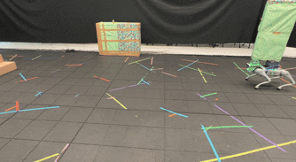

# MuJoCo Playground Training
This instruction explains how to train a [Unitree Go2 quadruped](https://www.unitree.com/go2) to track commanded velocities using [*Reinforcement Learning (RL)*](https://en.wikipedia.org/wiki/Reinforcement_learning) in [MuJoCo Playground](https://github.com/google-deepmind/mujoco_playground/). To follow the steps, refer to our [customized open-source repository](TBD).

**Task**: Track body-frame planar velocity commands: $\mathbf{c} = [v_x^c, v_y^c, \omega_z^c]$  
where $v_x$ and $v_y$ are the commanded linear velocities in the robot’s body frame, and $\omega_z$ is the commanded yaw rate.  
**RL algorithm:** [Proximal Policy Optimization (PPO)](https://arxiv.org/pdf/1707.06347)  

This instruction uses the `Go2JoystickFlatTerrain` environment and the [*RSL-RL*]((https://github.com/leggedrobotics/rsl_rl)) implementation of PPO through the `learning/train_rsl_rl.py` training script.

!!! note

    All parameter values and configuration details presented in this document are set for the current environment and training setup. They should not be interpreted as generic defaults for Unitree Go2 locomotion tasks.  

## Policy and environment setup
### Observation Space
**Actor Observation**:  
The actor receives proprioception information, each frame contains 45-dimensional observation:

| Term | Dimension | Noise amplitude |
| :---: | :---: | :---: |
| Local angular velocity | 3 | `+/-0.2` |
| Projected gravity | 3 | `+/-0.05` |
| Velocity commands | 3 | None |
| Joint position bias | 12 | `+/-0.01` |
| Joint velocity | 12 | `+/-0.01` |
| Previous actions | 12 | None |

Noise is uniform and independently sampled for each new frame.  
**Actor input**: Observation history of concatenating 10 frames (**450-dimensional**). It supplies short-term temporal context to the feed-forward actor.

**Critic Observation**:  
The critic receives the uncorrupted current actor frame and privileged information:

| Term | Dimension |
| :---: | :---: |
| Current actor observation | 45 |
| Local linear velocity | 3 |
| Base height above ground | 1 |

**Critic input**: **49-dimensional** and contains no history.  

### Action Space
The policy action is a normalized 12-dimensional vector, one value per
actuated Go2 joint in MuJoCo model order: $\mathbf{a}_t \in [-1, 1]^{12}$.  
After rollout perturbation noise and clipping, the environment computes:

\[
\mathbf{q}_{target} = \mathbf{q}_{default} + 0.5\mathbf{a}_t
\]

where 0.5 is action scale.  
**Note**: The action is not a torque command. It is converted to a joint-position target,
and the MuJoCo position actuators apply the configured PD gains.
See the
[MuJoCo actuator documentation](https://mujoco.readthedocs.io/en/stable/computation/index.html#actuation-model)
for the underlying actuation model.


### Rewards
At each control step, the environment computes

\[
r_t = \Delta t \sum_i s_i r_i, \qquad \Delta t = 0.02.
\]  

where $r_i$ and $s_i$ represent each reward term and its scale, $\Delta t$ is the control step.  
The full rewards, reward scales and definitions are listed below:

| Term | Scale | Definition |
| :---: | :---: | :---: |
| `tracking_lin_vel` | `+1.0` | $\exp\left(-\lVert \mathbf{v}_{xy}^{c}-\mathbf{v}_{xy}^{b}\rVert_2^2/0.25\right)$ |
| `tracking_ang_vel` | `+1.0` | $\exp\left(-\left(\omega_z^{c}-\omega_z^{b}\right)^2/0.25\right)$ |
| `height` | `+1.0` | $\exp\left(-10 \cdot \left(z_b-0.35\right)^2\right)$ |
| `lin_vel_z` | `-1.5` | $\left(v_z^b\right)^2$ |
| `action_rate` | `-0.05` | $\lVert \mathbf{a}_t-\mathbf{a}_{t-1}\rVert_2^2$ |
| `action` | `-0.1` | $\lVert \mathbf{a}_t\rVert_2^2$ |
| `ang_vel_xy` | `-0.05` | $\lVert \boldsymbol{\omega}_{xy}^{b}\rVert_2^2$ |
| `orientation` | `-5.0` | $\lVert \mathbf{g}_{xy}^{b}\rVert_2^2$, $\mathbf{g}^{b}$ is body-frame projected gravity |
| `pose` | `+1.2` | $\exp\left(-\sum_{j=1}^{12}w_j\left(q_j-q_j^{\mathrm{default}}\right)^2\right), \mathbf{w}=[1,1,0.1]^{\times 4}$ |
| `stand_still` | `-1.0` | $\mathbb{1}_{\lVert\mathbf{c}\rVert_2<0.01}\sum_{j=1}^{12}\left\|q_j-q_j^{\mathrm{default}}\right\|$ |
| `energy` | `-0.001` | $\sum_{j=1}^{12}\left \| \dot{q}_j\right\| \cdot \left\|\tau_j\right\|$ |

### Domain Randomization
[Domain randomization](https://arxiv.org/pdf/1703.06907) is used to reduce overfitting, improve robustness, and prepare the controller for deployment conditions. 

| Quantity | Distribution |
| :---: | :---: |
| Geometry friction scale | `U(0.5, 2.0)` |
| Body mass and inertia scale | `U(0.85, 1.15)` |
| Proportional gain `Kp` | `U(25.0, 45.0)` |
| Derivative gain `Kd` | `U(0.3, 1.6)` |
| COM offset | x/y `+/-0.05 m`, z `+/-0.04 m` |
| External Push  | `U(-1.0, 1.0)` |


### Environment Configuration
| Parameter | Value |
| :---: | :---: |
| Physics step, `sim_dt` | `0.004 s` (250 Hz) |
| Control step, `ctrl_dt` | `0.02 s` (50 Hz) |
| Physics substeps per action | `5` |
| Nominal episode length | `5,000` control steps (100 s) |
| Sampled time limit | `3,750 - 6,250` steps (75 - 125 s) |
| Nominal PD gains | `Kp = 35.0`, `Kd = 0.5` |
| Soft joint-limit factor | `0.95` |

### PPO Configuration

| Parameter | Value |
| :---: | :---: |
| Parallel environments | `2,048` |
| Steps per environment and iteration | `24` |
| Samples per iteration | `49,152` |
| Actor hidden dimensions | `[512, 256, 128]` |
| Critic hidden dimensions | `[512, 256, 128]` |
| Initial Gaussian action standard deviation | `0.5` |
| PPO clip parameter | `0.2` |
| Discount factor `gamma` | `0.99` |
| GAE parameter `lambda` | `0.95` |
| Learning rate | `1e-3` |
| Learning-rate schedule | adaptive; target KL `0.01` |
| Learning epochs per iteration | `10` |
| Mini-batches per epoch | `4` |
| Samples per mini-batch | `12,288` |
| Value-loss coefficient | `1.0` |
| Entropy coefficient | `0.01` |
| Maximum gradient norm | `1.0` |


## Installation
Clone our [customized open-sourced repository](TBD) and install *MuJoCo Playground* following [official guidance](https://github.com/google-deepmind/mujoco_playground/).  
Here we create a conda virtual environment for this task.  
```sh
conda create -n env_mujocoplayground python=3.12 -y  
conda activate env_mujocoplayground # make sure environment is always activated in following commands
pip install playground
cd mujoco_playground
```

## Train the policy
```sh
train-rsl-ppo --env_name=Go2JoystickFlatTerrain
```

## Play the policy
It is necessary to speficy `play-only`, `load_run_name`, and `checkpoint_num` (optional).  
```sh
train-rsl-ppo \
--env_name=Go2JoystickFlatTerrain \
--play_only \
--load_run_name=<run_name> \  # choose specific run_name
--checkpoint_num=<number>  # optional, choose specific checkpoint, if not specified, the last checkpoint is automatically chosen
```

## Export policy in ONNX format
This is for sim-to-sim validation and real-world deployment, we use [ONNX format](https://onnx.ai/onnx/intro/index.html) to deploy.  
```sh
train-rsl-ppo \
--env_name=Go2JoystickFlatTerrain \
--export_onnx_only \
--load_run_name=<run_name> \
--checkpoint_num=<number>
```

## Sim-to-Sim Validation
Please refer to Isaaclab Training *Sim-to-Sim Deployment with MuJoCo* section for details.

## Real-world Deployment
Refer to deploy [here](TBD).  
{width=500}

1. Export Policy into ONNX format file.  
```sh
train-rsl-ppo \
  --env_name=Go2JoystickFlatTerrain \
  --export_onnx_only \
  --load_run_name=<run_name> \
  --checkpoint_num=<checkpoint>
```
2. Check and revise `config.yaml`.  
In real robot deployment, some parameters (e.g. `Kp` and `Kd`) need to be adjusted based on different robot.  
Set the correct exported policy path: 
```yaml
policy:
  path: "model/policy_deploy.onnx"
```
For the real robot, enable `unitree_services`:
```yaml
unitree_services:
  enable: true
```  
**Note**: This makes the node call Unitree `SportClient::StandDown()` and `MotionSwitcherClient::ReleaseMode()` before low-level control. For MuJoCo sim-to-sim validation, set `unitree_services` to be `false`.  
The ROS2 node expects:  
```text
input:  obs      [1, 450]
output: actions  [1, 12]
```  
During policy control, the ROS2 node publishes two 12-joint messages in Unitree SDK motor order (`FR`, `FL`, `RR`, `RL`, with `hip`/`thigh`/`calf` for each leg):  
```text
- /network_output_raw: unscaled policy actions after finite-value handling and the configured `action_clip`.
- /target_action: final joint-angle commands, computed as `default_angles + network_output_raw * action_scale`.
```  
3. Build the workspace.  
Source the ROS 2 and Unitree SDK environment first, then:  
```sh
cd deploy
./run_build.sh
source install/share/go2_joystick_deploy/local_setup.bash
```  
**Note**: Source `install/share/go2_joystick_deploy/local_setup.bash` in every terminal
that uses ROS CLI tools with the custom `JointAngularPositions` message.  
4. Run With Unitree MuJoCo
```sh
cd deploy
./locomotion_node --net lo --config config.yaml
```  
In another terminal, run the existing command publisher:  
```sh
python ../deploy/terminal_cmd.py  # or wireless_cmd.py to use joystick controller
```  
5. **Real Robot Notes**  
On shutdown or `Ctrl`+`C`, the node interpolates to `sit_angles` and then sends a
damping command.