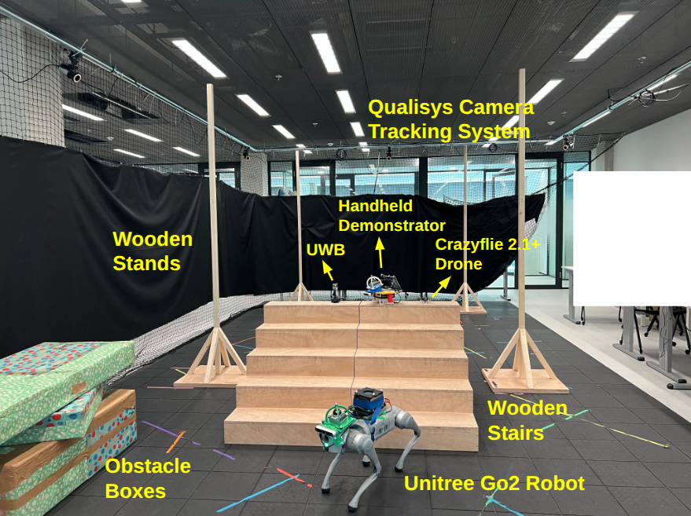

# Embodied AI Lab for Education

Welcome to the Embodied AI Lab for Education, an open-source platform providing practical guides, software, and teaching resources for robotics and embodied intelligence.

  

The lab supports research-driven education through hands-on experiments in perception, localization, control, and autonomous systems. Its facilities include **Unitree Go2 quadruped robots**, a **Qualisys motion-capture system**, **Crazyflie 2.1+ drones**, an **ultra-wideband (UWB) localization network**, **wooden stairs and stands**, and **custom-designed handheld platforms**.

This documentation introduces the main hardware platforms and experimental tools available in the lab. You will learn how to work with:

- [Qualisys camera-based motion tracking](./mocap/camera_tracking.md)
- [Crazyflie 2.1+ drones](./mocap/drone.md)
- [Ultra-wideband localization](./mocap/uwb.md)
- [Visual-inertial odometry](./mocap/vins_mono.md)
- [LiDAR-inertial odometry](./mocap/resple.md)
- [Manus motion-capture gloves](./mocap/gloves.md)

Together, these tools form a flexible platform for developing, testing, and demonstrating embodied AI methods.

The following section, [**Unitree Go2 Sim-to-Real**](./go2/go2_start.md), provides a complete workflow for training locomotion policies in simulation, validating them across simulators, and deploying them on a real Unitree Go2 robot.