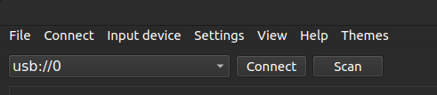
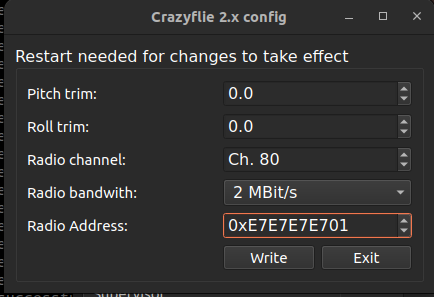
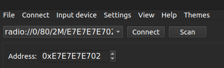
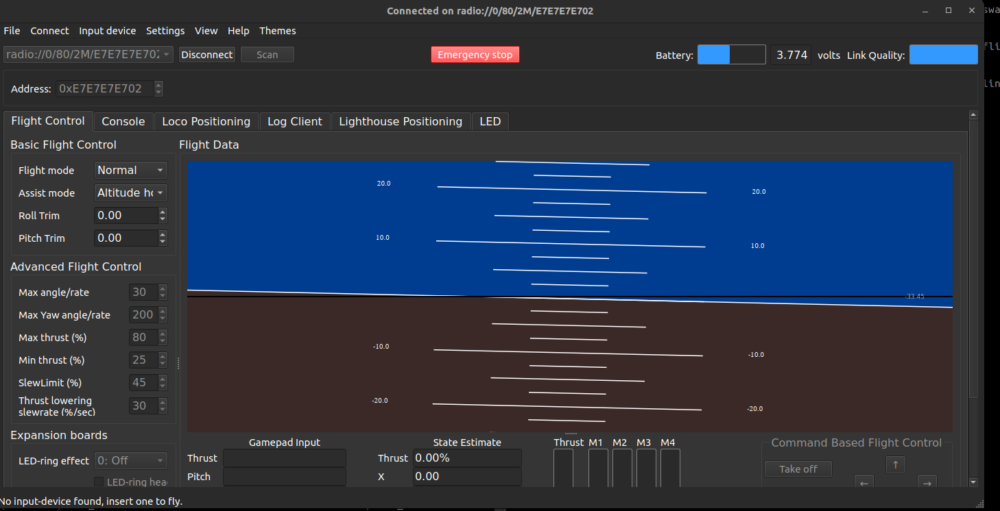
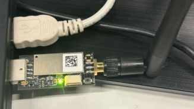
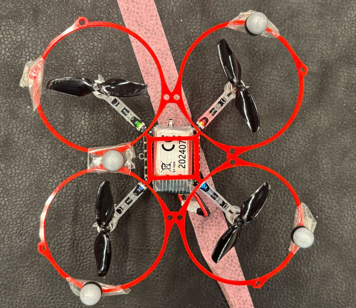
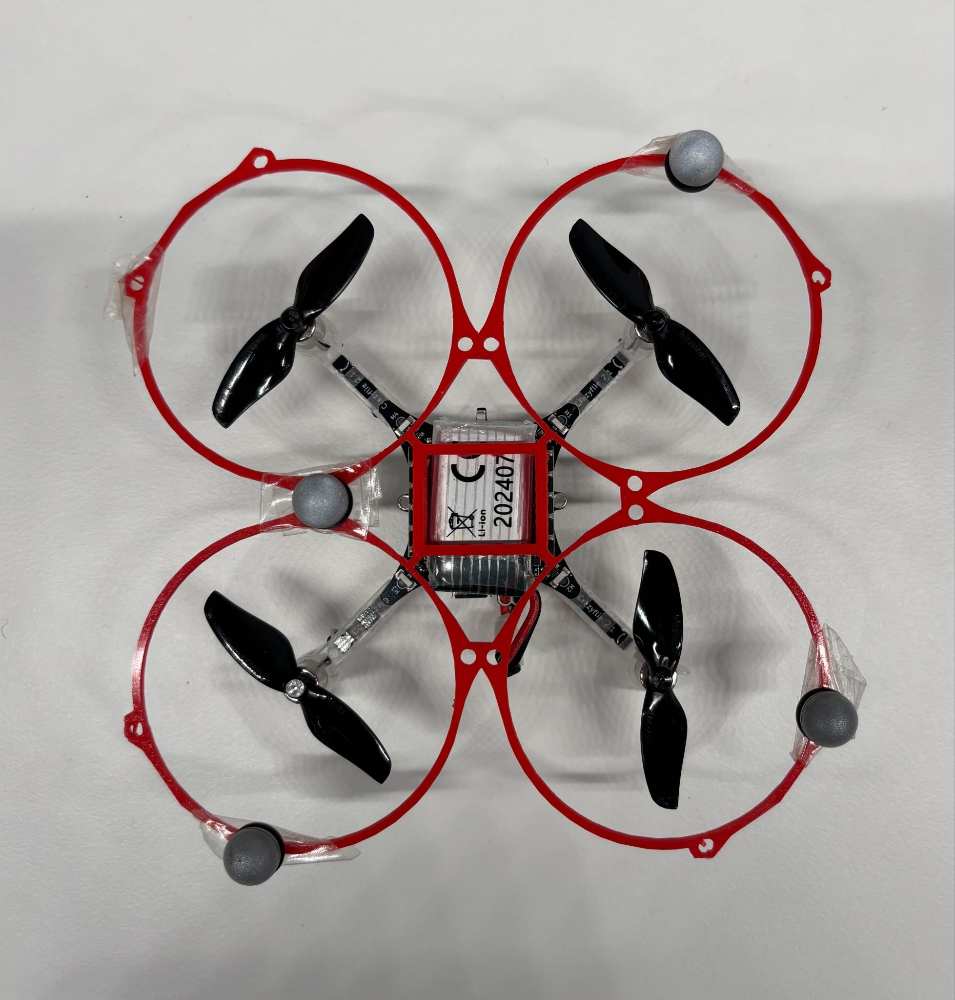
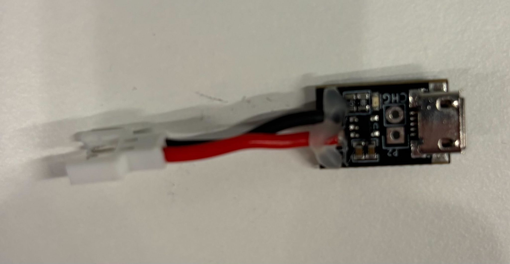

# Crazyflie 2.1+ Drone

## Configuration
### Install the Crazyflie Client (cfclient)
More details can be found [here](https://www.bitcraze.io/documentation/repository/crazyflie-clients-python/master/installation/install/).

1. Install dependencies
```sh
sudo apt install git python3-pip libxcb-xinerama0 libxcb-cursor0
# Activate virtual environment to avoid conflicts of dependencies. Here we use Miniconda as an example. 
conda create -n env_1_cfclient python=3.12 # “env_1_cfclient” is the name of this virtual environment and can be changed to other names.
conda activate env_1_cfclient 
pip3 install --upgrade pip
conda deactivate # This command can be skipped if you keep the following steps within the same terminal.
```
2. Set USB permissions, see also [here](https://www.bitcraze.io/documentation/repository/crazyflie-lib-python/master/installation/usb_permissions/) for more details.
```sh
sudo groupadd plugdev
sudo usermod -a -G plugdev $USER
cat <<EOF | sudo tee /etc/udev/rules.d/99-bitcraze.rules > /dev/null
# Crazyradio (normal operation)
SUBSYSTEM=="usb", ATTRS{idVendor}=="1915", ATTRS{idProduct}=="7777", MODE="0664", GROUP="plugdev"
# Bootloader
SUBSYSTEM=="usb", ATTRS{idVendor}=="1915", ATTRS{idProduct}=="0101", MODE="0664", GROUP="plugdev"
# Crazyflie (over USB)
SUBSYSTEM=="usb", ATTRS{idVendor}=="0483", ATTRS{idProduct}=="5740", MODE="0664", GROUP="plugdev"
EOF
sudo udevadm control --reload-rules
sudo udevadm trigger
```

3. Install *cfclient*
```sh
conda activate env_1_cfclient # Skip this command if you are already in the virtual environment 
pip3 install cfclient
```

4. Launch *cfclient*
```sh
conda activate env_1_cfclient # Skip this command if you are already in the virtual environment  
cfclient
```

### Configure Crazyflie’s address in cfclient for the first use of Crazyflie
1. Connect the *Crazyflie* with computer via micro USB cable
2. Open *cfclient*. The interface looks as follows

3. Click on `Scan` -> `usb://0` will show in the drop down menu ->  
Click on `Connect`  
{ width="400" }  
4. After successful connection, define the address by going to tab `Connect/Configure 2.x` ->  
In the following window, change the last two digits of `Radio Address` to e.g., `01` ->  
Click on `Write`  
{ width="400" }  
4. Exit *cfclient*

### Connect to the Crazyflie through Crazyradio
**The following order matters**

1. Turn on the *Crazyflie* by connecting it to its battery.  
A successful start should have LEDs as shown [here](https://www.bitcraze.io/documentation/tutorials/getting-started-with-crazyflie-2-x/) in Section *Getting to know your Crazyflie*.
2. Plug in the *Crazyradio*
3. Launch cfclient
4. Change the following `Address` to the desired one  
(e.g., the one just configured before)  
{ width="400" }  
5. Click on `Scan` to detect available *Crazyflie* addresses  
6. Select the desired *Crazyflie* address from the drop down menu  
7. **Important**: Before clicking on ‘connect’, briefly unplug and then plug in the *Crazyradio* again
8. Click on `Connect` in the *cfclient*.  
A successful connection will be shown on the top of the window `Connected on radio…`  
Failed connection: always `Connecting …`
  
**Note**: This unplug and plug-in action in step 7 helps resolve potential connection issues as noted [here](https://github.com/orgs/bitcraze/discussions/1682), which causes *cfclient* to get stuck during the connection stage. Although an alternative solution (downgrading the firmware) is mentioned on the same page, it has not been tested yet.   
If the connection succeeds, the flight data on the right side of *cfclient* should show the orientation of the *Crazyflie*. The LEDs on *Crazyradio* and *Crazyflie* should look like this:
{ width="400" }  
*Crazyradio* has green & yellow LED on  
{ width="400" }  
*Crazyflie*: M1 blinking red twice every second (constantly red means error), M2 & M3 constantly blue, M4 constantly yellow.  
Other cases please refer to [here](https://www.bitcraze.io/documentation/tutorials/getting-started-with-crazyflie-2-x/) in section *Understanding LEDs*.
9. *Optional*: Check the box `View/Tabs/Parameters` to check the available topics.

### Define Crazyflie coordinate in Qualisys
1. Attach markers.  
The arrangement of markers is crucial for accurate pose estimation and precise control of the *Crazyflie*. Consider using an **asymmetric** layout of markers.  
Refer to the example picture below.  
{ width="400" }  
2. Open QTM and define a rigid body for the *Crazyflie* with the origin set at its **center**.  
Make sure that the x-axis is oriented towards the **front** (as shown in [Section *Getting to Know Your Crazyflie*](https://www.bitcraze.io/documentation/tutorials/getting-started-with-crazyflie-2-x/)), and the z-axis points **upwards**.
3. Name the rigid body `cfx`, where `x` corresponds to the last digits of the *Crazyflie*'s address (as a rule of thumb).  
For example, if the address is `0xE7E7E7E702`, name it `cf2`; if the address is `0xE7E7E7E701`, name it `cf1`, and so on. This will later be used in the config file. 

## Clone the repository and compile

```sh
mkdir cffly_ws && cd cffly_ws
mkdir src && cd src
git clone https://github.com/IMRCLab/crazyswarm2.git
cd ..
colcon build --symlink-install
source install/setup.bash
```

To test whether everything has been set up properly:  
1. Connect the computer to the Qualysis WiFi  
2. Setup config files properly:  
Change the yaml file `crazyswarm2/config/crazyflies.yaml`: enable related *Crazyflie*, make sure its name (`cfx`) and `uri` match the names defined in QTM and the address in the cfclient, respectively.  
Set the `hostname` in file `crazyswarm2/crazyswarm2/crazyflie/config/motion_capture.yaml` according to the IP address of Qualisys.  
3. Turn on *Crazyflie* and connect to it through *Crazyradio*  
4. Test whether the *Crazyflie* can be detected/connected and Qualysis is working well:
```sh
ros2 launch crazyflie launch.py backend:=cflib
```

**Note**: For safety reasons of *Crazyflie*, make sure every following thing looks correct:

- Check if the *Crazyflie*'s position displayed in the Rviz window reflects its real-world position. If no position is displayed or the position is drifting, something is wrong. 
- *Crazyradio* & *Crazyflie* should have LEDs illuminated before.

## Launch an example of Crazyflie taking off & landing using ROS2

1. Make sure your computer is connected with *Crazyflie* through *Crazyradio*
2. Make sure Qualisys is connected 
3. Make sure that the area around the propellers is **clear** of any **obstacles**, such as battery cables or tape on the frame. Otherwise *Crazyflie* will have problems taking off/flying.
4. Open terminal 1 and run
```sh
ros2 launch crazyflie launch.py backend:=cflib
```
This ROS node works as a server, meaning that it cannot operate the drone independently. It needs to work with the command in terminal 2.  
**Note 1**: Make sure everything mentioned before (the *Crazyflie*'s position in the Rviz window, LEDs, logs in the terminal, etc.) looks good before running the second command in terminal 2.  
**Note 2**: If you terminate this node and wish to launch it again, make sure to unplug *Crazyradio* and then plug it back in. The green and yellow LEDs on the *Crazyradio* indicate a successful connection.  
**Remark 1**: If you encounter the following error:
```sh
“[crazyflie_server-3]   what():  Issue with connection radiobroadcast://*/80/2M. Your radio with firmware 3.2 does not support broadcast communication. Please upgrade your Crazyradio firmware!”
```
It can be resolved by commenting out the code block between lines `198` and `203` in `crazyflie-link-cpp/src/CrazyradioThread.cpp` (as shown [here](https://github.com/bitcraze/crazyflie-link-cpp/blob/fcde6a0850f2f3127fb5f65b76aaabda530d7cd9/src/CrazyradioThread.cpp#L198-L203)). This is a bug as noted [here](https://github.com/IMRCLab/crazyswarm2/issues/245).  
**Remark 2**: Using `cflib` as backend is important for *Crazyradio2.0* as noted [here](https://github.com/IMRCLab/crazyswarm2/issues/570) and [here](https://github.com/IMRCLab/crazyswarm2/discussions/566#discussioncomment-10703248).


## Notes
1. Make sure the *Crazyflie* is well balanced, e.g., check if the battery is properly placed.  
2. Before running any ros node, make sure the *cfclient* is closed.  
3. The *Crazyflie* battery is charged using the device shown below.  
Connect the battery to one end of the charger and the micro-USB cable to the other end. Then connect the micro-USB cable to a laptop to supply power for charging.
{ width="300" }

## Student Project Examples

- **Model Predictive Control for Trajectory Tracking on Crazyflie 2.1 Quadrotor** ([Poster](https://asig-x.github.io/comenius/posters/Sam_Nico_2026_Integration_Project.pdf))  
N. C. Smith, S. P. Jones, MSc Integration Project, MSc Systems and Control, University of Groningen (RUG), 2026.

