# Ultra-wideband (UWB) Network Localization

## Loco Positioning System (LPS) configuration

**Note 1**: The instructions provided [here](https://www.bitcraze.io/documentation/tutorials/getting-started-with-loco-positioning-system/) for UWB configuration are clear and easy to follow. It is recommended reviewing them carefully to understand each step and how to use the system effectively. The notes below are intended **only** to highlight a few additional suggestions and differences I encountered.  
**Note 2**: The current anchors are already configured and ready to use. If you wish to keep the existing anchor configuration, you only need to **complete Step 1** and can then proceed directly to the next section ***Loco Positioning System usage***.

1. Download and install the Loco Positioning configuration tool ([lps-tools](https://github.com/bitcraze/lps-tools)) and setup USB access right.  
**Note 1**: Installing *lps-tools* via `pip3` requires different dependencies on libraries (`pyusb`) than installing *cfclient*. To avoid conflicts in dependencies, create another virtual environment as follows:
```sh
conda create -n env_2_lpstools python=3.12 # “env_2_lpstools” is the name of this virtual environment and can be changed to other names.
conda activate env_2_lpstools
cd /path/to/lps-tools/respository
pip3 install -e .[pyqt5]
conda deactivate
```
**Note 2**: In step *USB access right on Linux* [here](https://github.com/bitcraze/lps-tools#running-instruction), the sign `#` should be removed when putting it in the terminal. Check [this issue](https://github.com/bitcraze/lps-tools/issues/23) for more details.  
2. Download the Loco Positioning node firmware.  
3. Update the nodes.  
**Note 1**: Updating the LPS node through firmware may take several minutes. After clicking the `Update` button, it turns grey, and it is normal for the progress bar to remain 0% for about a minute before showing any values.  
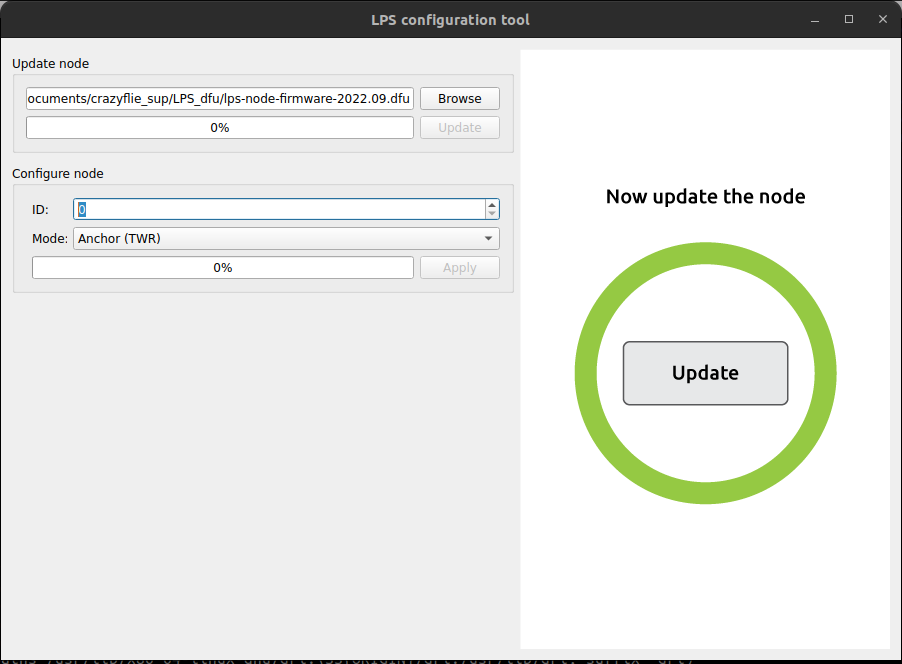  
**Note 2**: If you run into the following issue, restarting the computer solves the problem.  
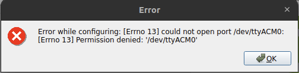{ width="500" }  
4. Configuring the nodes into anchors.

## Loco Positioning System (LPS) usage

1. Connect all anchors to the power source.  
A complete anchor set should resemble the configuration shown in the following picture.  
**Note 1**: The numbers in the top-right corner indicate the anchor IDs.  
**Note 2**: When connecting or disconnecting a power bank, always plug and unplug the cable from the power bank end. This approach is easier and helps protect the micro-USB port on the anchor board from wear or damage.  
**Note 3**: make sure all powerbanks have enough power the day before conducting experiments.  
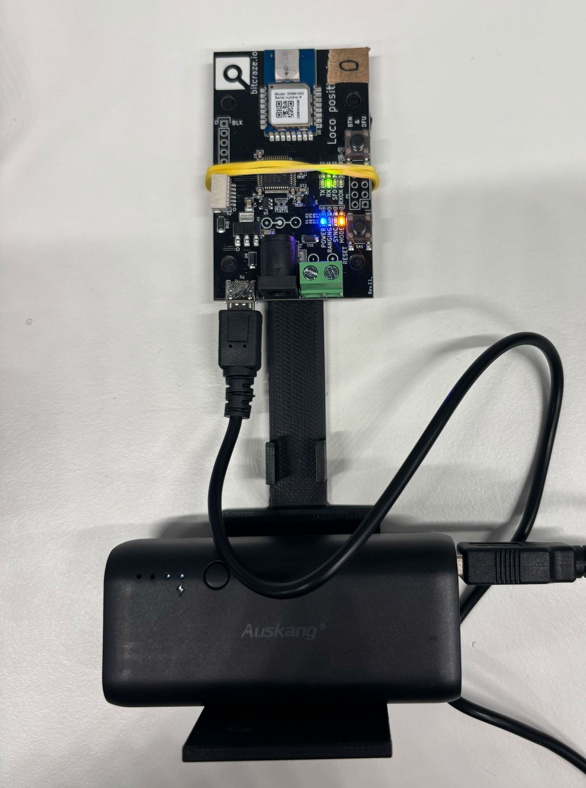{ width="400" }  
2. Turn on the *Crazyflie*.  
**Note**: Communication between the computer and the anchors is relayed through *Crazyflie*.  
Therefore, a *Crazyflie* equipped with an active [Loco Positioning Deck](https://store.bitcraze.io/products/loco-positioning-deck) must be powered on in order for the anchors to be successfully detected in both *cfclient* and the ROS 2 driver.  
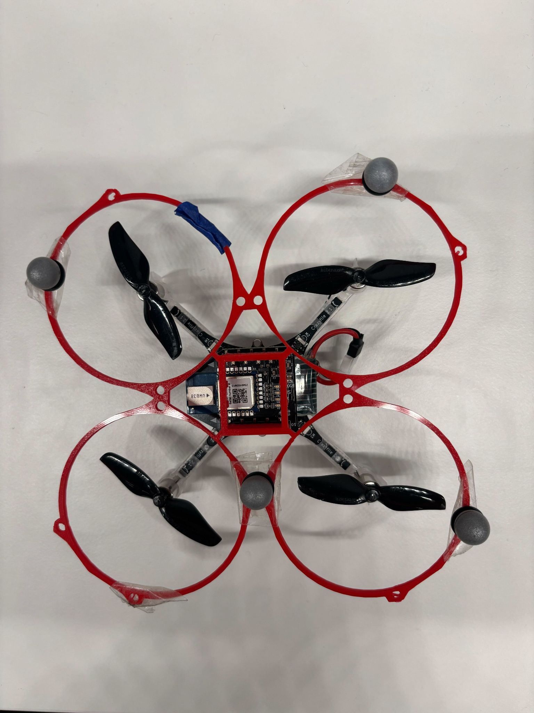{ width="400" }  
3. Check anchor status in *cfclient*.  
Go to the `Loco Positioning` tab ->  
Check the `Crazyflie status` panel.  
Anchors that are successfully detected are shown in green boxes, while undetected anchors are shown in red.  
The reference image below illustrates a successful detection of anchors `0`~`5`, while anchors `6` and `7` are not detected. (Currently, only six anchors are required for localization.)  
Green dots represent the anchor locations, and the blue dot indicates the estimated tag position. Walk around the space and observe whether the blue dot provides reasonable position estimates.  
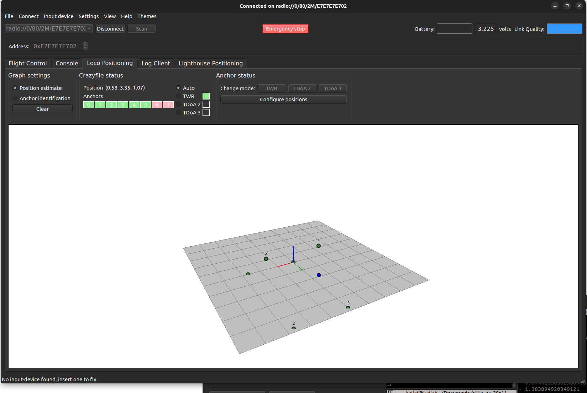  
4. Place the anchors according to the layout shown in the reference image above.  
In the current setup, anchors `0`~`3` are placed on the ground, while anchors `4` and `5` are mounted on the pole. The figure below shows a top-down view of the configuration. All dimensions are given in meters.  
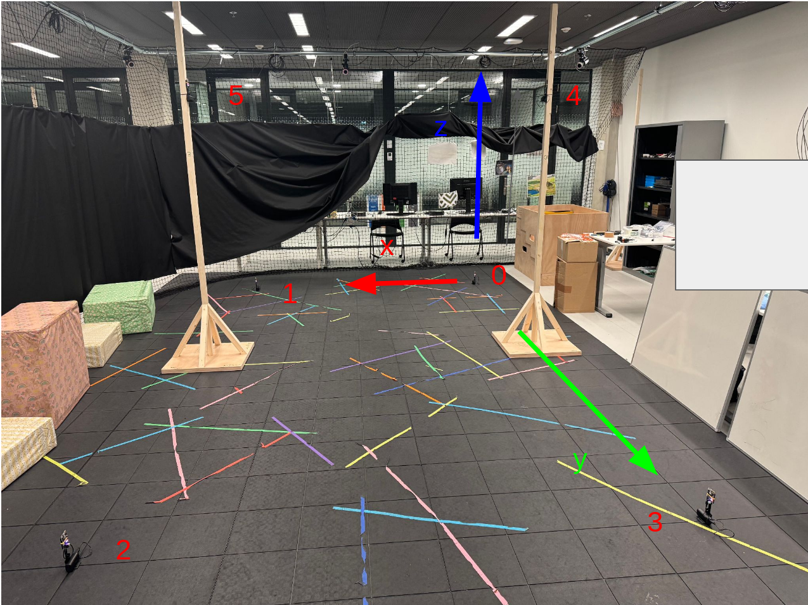  
**Note 1**: Anchor `0` defines the origin of the coordinate frame. The positions of all other anchors are specified relative to this anchor.  
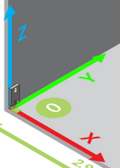{ width="200" }  
Current anchor positions `[x,y,z]` in meters (they correspond to the coordinates in the step below):
```m
an_0: [0.00, 0.00, 0.00]
an_1: [2.70, 0.00, 0.00]
an_2: [2.70, 4.80, 0.00]
an_3: [0.00, 4.80, 0.00]
an_4: [0.00, 2.40, 2.00]
an_5: [2.70, 2.40, 2.00]
```
**Note 2**: The anchor antenna is located at the orange-marked area shown below. Ensure that this point is positioned according to the dimensions specified above. The lab floor mat has dimensions of `0.3 × 0.3` m², which can be used as a convenient reference when arranging the anchors.  
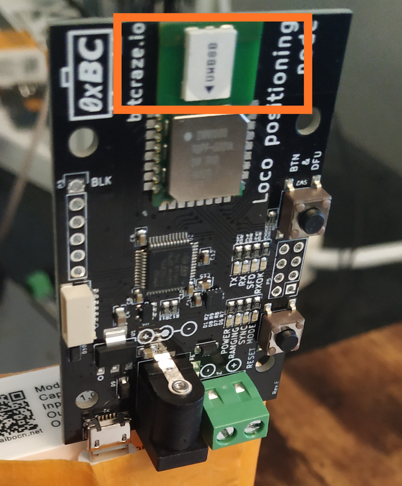{ width="400" }  
**Note 3**: When placing anchors `4` and `5`, align the bottom of each anchor stand with the marked line on the pole.  
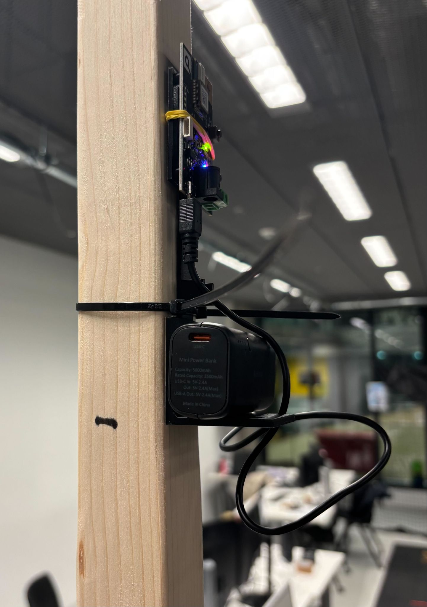{ width="300" }
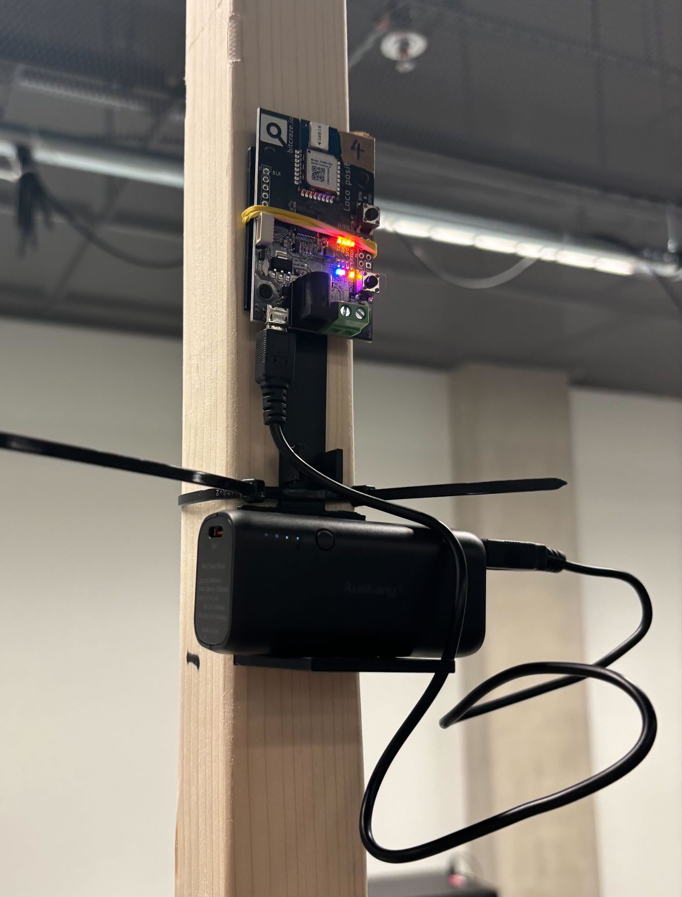{ width="325" }  
5. Configure anchor positions (**skip this step** if the anchor locations do not need to be changed).  
Click `Get from anchors` to load the current anchor configuration.
When you select and modify a coordinate, it will turn red to indicate an unsaved change. 
After making the necessary updates, click `Write to anchors` to save the new configuration. Once the process is complete, all blocks should turn green, as shown in the reference image on the right.
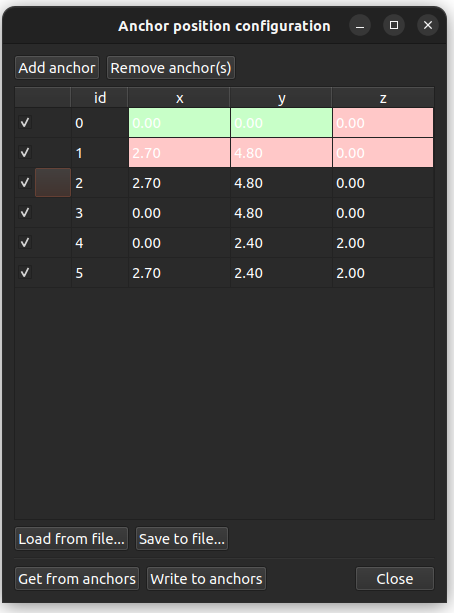{ width="300" }
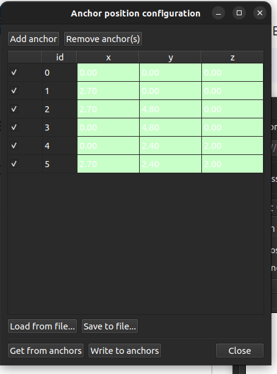{ width="300" }  
6. Check measurements using ROS  
To check out UWB readings of Crazyflie in ROS2, run the following command in the workspace
```sh
ros2 launch crazyflie launch.py backend:=cflib
```
In another terminal, source this workspace and list all available topics using the following command  
```sh
ros2 topic list
```
To see the content of each topic, run  
```sh
ros2 topic echo xxx # replace ‘xxx’ with the specific topic name, e.g., /cf2/uwb_data
```
7. Record desired topics by opening a new terminal and using  
```sh
ros2 bag record -o bag_name -a
```
**Note**: before launching the command, source the respective workspace to make the topics visible.  
8. Download our code and data from [here](../uwb/uwb-practical.zip).
9. Convert recorded bags to .txt file (`convertROSbag2Txt.py`)
```sh
# Usage: 
python3 ./convertROSbag2Txt.py <bag_path> [imu_topic] [uwb_topic] <out_path>
# e.g., 
python3 ./convertROSbag2Txt.py recorded_bag1 /cf2/imu_data /cf2/uwb_data recorded_data_txt
```
9. Visualize recorded data (`visualizeData.m`)
10. Run a linear least square example (`runLinearLS.m`)
11. Run an ESKF example (`runESKF.m`)  
**Note**: You could adjust the initial state, covariance, and measurement noise to see the change in performance. You could also implement the mahalanobis distance in the update step for outline rejection.  
12. Definition of IMU and UWB topics:  
**Note**:  
The topic `/cf2/imu_data` outputs 6-axis IMU data `["acc.x", "acc.y", "acc.z", "gyro.x", "gyro.y", "gyro.z"]`, with accelerometer readings of unit $g$ (9.81 $m/s^2$) and gyroscope readings of unit degree/s.  
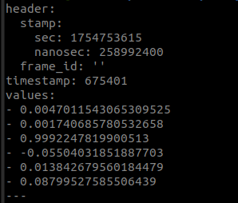{ width="300" }  
The topic `/cf2/uwb_data` outputs the distance between the tag and the anchor in TWR mode.
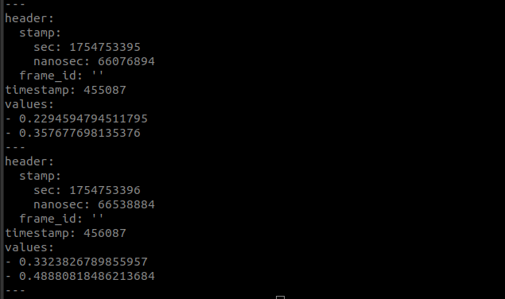{ width="300" }  
The following instructions show how to modify them or add UWB measurements from more anchors.
Go to the config file `crazyswarm2/crazyflie/config/crazyflies.yaml` [here](https://github.com/IMRCLab/crazyswarm2/blob/main/crazyflie/config/crazyflies.yaml), under `all/firmware_logging/custom_topics`, change the `vars` to what we desire and `frequency`.  
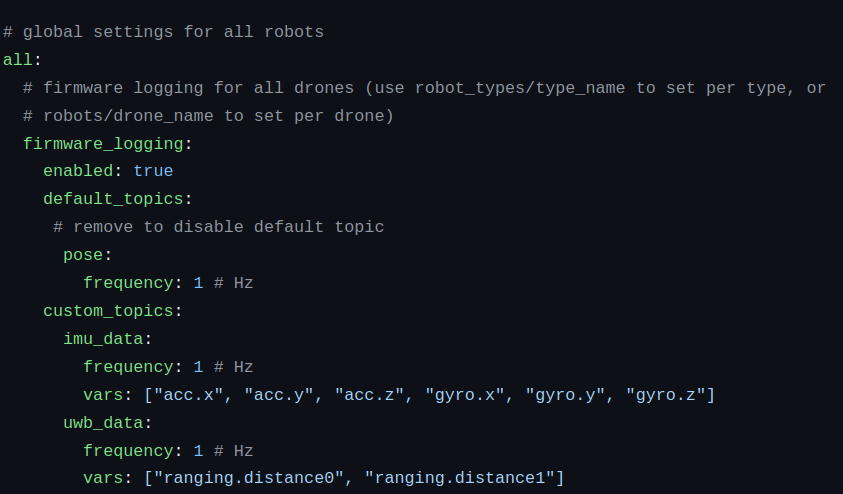{ width="400" }  
13. Additional reference:  
Log IMu data: https://github.com/IMRCLab/crazyswarm2/issues/601  
Log UWB data: https://github.com/USC-ACTLab/crazyswarm/issues/283  
Others: https://www.bitcraze.io/documentation/repository/lps-node-firmware/master/development/ros/  
https://github.com/whoenig/crazyflie_ros/tree/ros2  
UWB anchor stand 3D print: https://github.com/bitcraze/bitcraze-mechanics/blob/master/LPS-anchor-stand/anchor-stand.stl 


