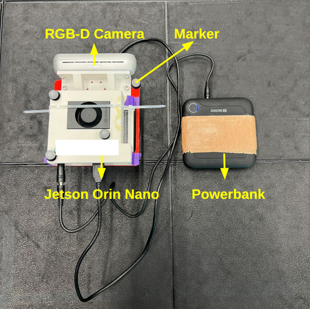
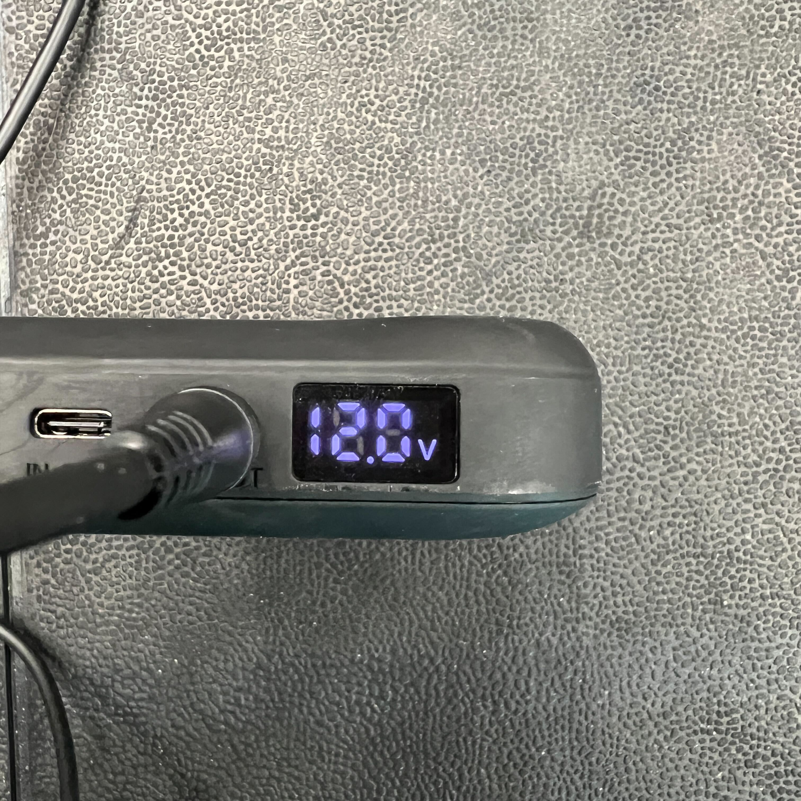
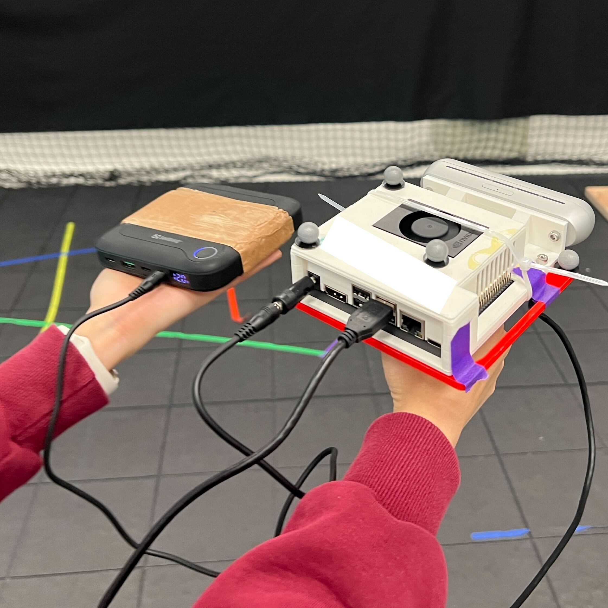
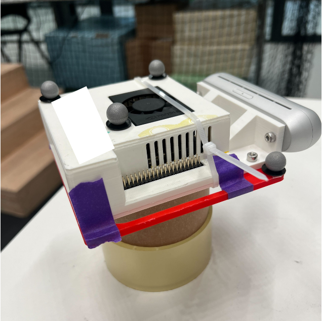
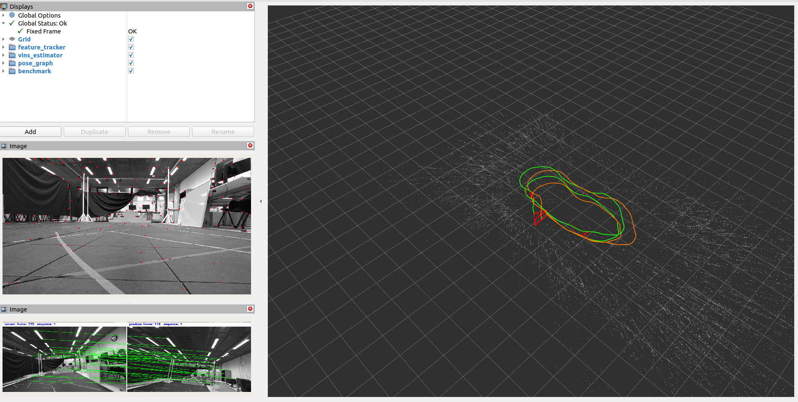

# VINS-Mono Demonstration

This is instruction of using our handheld demonstrator for [VINS-Mono](https://ieeexplore.ieee.org/document/8421746), which is a classical monocular visual SLAM system. The [original repository](https://github.com/HKUST-Aerial-Robotics/VINS-Mono) targets ROS1, therefore we use a [modified ROS2 version](https://github.com/dongbo19/VINS-MONO-ROS2), [Qualisys ROS2 project](https://github.com/MOCAP4ROS2-Project/mocap4ros2_qualisys) and its [ROS messages](https://github.com/MOCAP4ROS2-Project/mocap4r2_msgs) as the base of our code.


## Equipment Overview  
The mobile experimental platform is used to record data, then the lab computer is used to run VINS-Mono and evaluate.  
The mobile experimental platform consists of a [Jetson Orin Nano](https://www.nvidia.com/en-us/autonomous-machines/embedded-systems/jetson-orin/nano-super-developer-kit/), a [RealSense D455 RGB-D camera](https://www.realsenseai.com/products/real-sense-depth-camera-d455f/), and a powerbank. Tracking markers are pre-attached to the platform for use with the camera tracking system.  
{width=400}

**Safety Instructions:**

- Always verify that the powerbank voltage is set to **12.0V before** connecting it to the Jetson Orin Nano.  
{width=300}  
- Hold the platform and powerbank securely during data recording.  
{width=300}  
- When not in use, place the platform in the designated resting position as shown below to prevent it from tipping over and to keep the markers in their correct positions.  
{width=300}

## How to use
### Environment Setup
**On the computer:**  
Ensure that all required dependencies are installed on the system (*Ubuntu 22.04*).  
1. Check [ROS2 Humble](https://docs.ros.org/en/humble/index.html) installation.  
```sh
source /opt/ros/humble/setup.bash
echo $ROS_DISTRO
```
If `humble` is printed, *ROS2 Humble* is installed correctly. If an error occurs, please install *ROS2 Humble* by following the [official installation guide](https://docs.ros.org/en/humble/Installation/Ubuntu-Install-Debs.html), then re-run the commands above to verify.  
2. Install the system packages required by VINS-Mono.
```sh
sudo apt install libopencv-dev libceres-dev libeigen3-dev
```  
3.  Install [`evo`](https://github.com/MichaelGrupp/evo) for trajectory evaluation.  
```sh
pip install evo
```  
**Note**: Do not use any *Conda* virtual environment (*Anaconda*, *Miniconda*, etc.), as it is incompatible with ROS. Use the system Python3 installation instead.
4. Install the remaining Python packages required for the evaluation script.  
```sh
pip install "numpy<1.25" scipy sophuspy
```  
Then uninstall the pip version of `matplotlib` to avoid conflicts with the system installation.  
```sh
pip uninstall matplotlib
```

**On the Jetson Orin Nano:**  
1. Install the [RealSense ROS2 driver](https://github.com/IntelRealSense/realsense-ros?tab=readme-ov-file#installation-on-ubuntu) and [Qualisys ROS2 driver](https://github.com/MOCAP4ROS2-Project/mocap4ros2_qualisys) follow their official guidance.  
Check the hardware:  
Connect the RealSense D455 camera to the Jetson Orin Nano via USB-C:  
```sh
realsense-viewer  # should be performed directly on the Nano with a monitor
```  
If a viewer window opens displaying color and depth images, the RealSense driver installation is complete.  
Check the Qualisys driver:
```sh
source /opt/ros/humble/setup.bash
cd mocap_ws
colcon build  # only needed if not previously built
source install/setup.bash
ros2 launch qualisys_driver qualisys.launch.py
```  
After launching drivers successfully, open another terminal:  
```sh
source /opt/ros/humble/setup.bash
cd mocap_ws
source install/setup.bash
ros2 topic echo /rigid_bodies
```
If messages are printed to the terminal, the Qualisys driver is functioning correctly.

### Project Workspace Setup
**On the computer:**  
1. Create the workspace and install the required repositories.  
Create the ROS 2 workspace:  
```sh
mkdir -p vio/ros2_ws/src && cd vio/ros2_ws/src
```  
Clone the required repositories below into the `src` directory, then install and configure their dependencies according to each repository’s official documentation.
 
- [VINS-MONO-ROS2](https://github.com/dongbo19/VINS-MONO-ROS2)  
- [mocap4ros_qualisys](https://github.com/MOCAP4ROS2-Project/mocap4ros2_qualisys)  
- [mocap4r2_msgs](https://github.com/MOCAP4ROS2-Project/mocap4r2_msgs)  

After setup, add the [`eval_trajectory.py`](../vio/eval_trajectory.py), [`trajectory_aligner.py`](../vio/trajectory_aligner.py) to the `vio` directory.  
The final workspace structure should be:  
```text
vio/ 
├── ros2_ws/ 
│   └── src/ 
│       ├── mocap/ 
│       ├── mocap4ros2_qualisys/ 
│       ├── mocap_msgs/ 
│       └── vins_mono_ros2/ 
├── eval_trajectory.py 
└── trajectory_aligner.py
```  
Add the custom configuration file.  
Place the customized configuration file [`config_asig.yaml`](../vio/config_asig.yaml) at the following path:  
```text
vio/ros2_ws/src/vins_mono_ros2/config_pkg/config/config_asig.yaml
```  
Make sure the filename and directory structure match exactly, as the system expects the configuration file at this location.  
2. Build the ROS Packages.  
```sh
cd ros2_ws
source /opt/ros/humble/setup.bash
rm -rf build install log
colcon build
```
If `colcon` is not found, install it with:  
```sh
sudo apt install python3-colcon-common-extensions
```

### Ethernet Configuration
Ensure both the computer and the Jetson Orin Nano are connected to the local Wi-Fi. Open the network settings on the computer and set the IPv4 address of the network interface to `Manual`. Set the IPv4 address to `192.168.101.xx` (for example) where `xx` can be freely chosen. Set the network mask to `255.255.255.0`.

### Launch Drivers on the Jetson Orin Nano
From the computer, establish an `SSH` connection to the Jetson Orin Nano. Note that an `SSH` connection must be established in every new terminal session before executing commands on the Nano.  
1. Launch the RealSense driver.  
```sh
# SSH Terminal 1
source /opt/ros/humble/setup.bash
ros2 run realsense2_camera realsense2_camera_node --ros-args -p unite_imu_method:=2 -p rgb_camera.color_profile:=1280x720x15
```  
2. Launch the Qualisys driver.  
```sh
# SSH Terminal 2
source /opt/ros/humble/setup.bash
cd mocap_ws
# colcon build  # only needed if not previously built
source install/setup.bash
ros2 launch qualisys_driver qualisys.launch.py
```  
**Note:** Always verify that the Qualisys driver is publishing correctly before recording the data.  


### Record the data  
**Record guidelines**

- Place the platform at the center of the motion capture area before starting.  
- Walk freely within the lab space and ensure the trajectory **includes at least one loop closure**.  
- Do not approach the edges of the black padding, as this may cause the camera tracking system to lose sight of the markers.  
- Keep the recording duration **within approximately 45 seconds**, as the Jetson Orin Nano may begin dropping messages beyond this limit.  

With both drivers running, begin recording data in a third SSH terminal on Jetson Orin Nano. You may change `my_data` if desired:  
```sh
# SSH Terminal 3
source /opt/ros/humble/setup.bash
# To avoid errors in finding mocap_qualisys topic
cd mocap_ws
source install/setup.bash 
# Record data
mkdir -p ~/example_data  # create directory if it does not exist
ros2 bag record /camera/camera/color/image_raw /camera/camera/imu /rigid_bodies --output example_data/my_data
```

Once you have completed your recording, press `Ctrl`+`C` in SSH Terminal 3 to stop recording. The bag file will be saved to `example_data/my_data`. Stop both the RealSense and Qualisys drivers at this point.  

Transfer the recorded data to the computer. 

### Run VINS-Mono
**On the computer:**  
Run VINS-Mono on your recorded data. In the working directory on the computer, open four terminals and execute the commands in the **specified order**:  
```sh
# Terminal 1
source ros2_ws/install/setup.bash
ros2 launch feature_tracker vins_feature_tracker.launch.py
```
```sh
# Terminal 2
source ros2_ws/install/setup.bash
ros2 launch vins_estimator euroc.launch.py
```
```sh
# Terminal 3
source ros2_ws/install/setup.bash
ros2 bag play example_data/my_data
```
```sh
# Terminal 4
source ros2_ws/install/setup.bash
mkdir -p results/
ros2 bag record --output results/vinsmono_data_my_data /pose_graph/pose_graph_path /vins_estimator/path /rigid_bodies /leica/position
```  
*RViz* should launch and display the estimated trajectories as below. The orange path represents the estimated trajectory before loop closure, and the green path represents the trajectory after loop closure.  
  

Once the sequence has finished, press `Ctrl`+`C` in Terminal 4 to stop recording.  

### Evaluation  
After successfully running VINS-Mono, evaluate the results using the `evo` package. First, generate the trajectory files:  
```sh
python3 eval_trajectory.py --bagpath results/vinsmono_data_my_data --rigid-body-name cam --save-path ./results/
```  
This script displays a plot of the ground truth and estimated trajectories, and saves them as:  
```text
results/gt_traj.txt
results/est_traj.txt
```  
Then run the evaluation:  
```sh
evo_ape tum results/gt_traj.txt results/est_traj.txt --align --plot
```  
This computes the Absolute Pose Error (APE) of the estimated trajectory. A mean translation error of approximately 0.1 - 0.2m is expected. 

